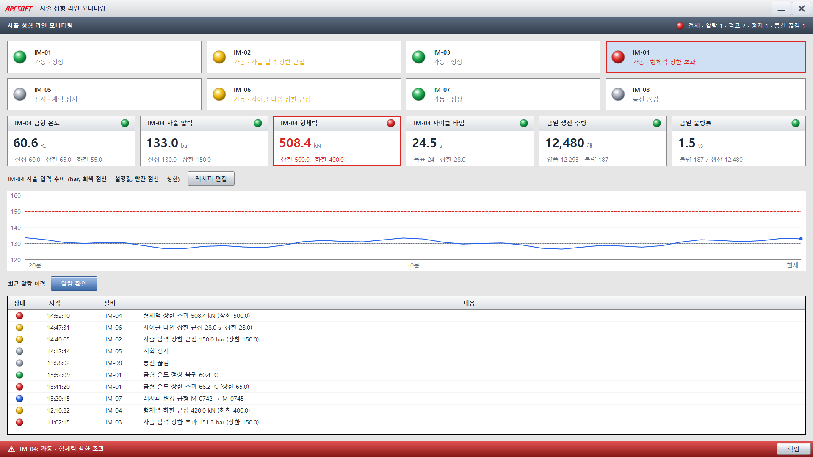
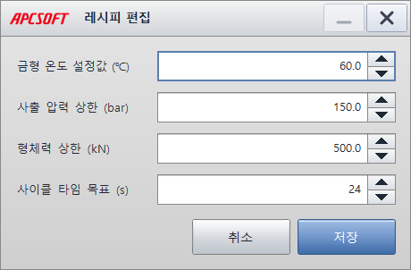
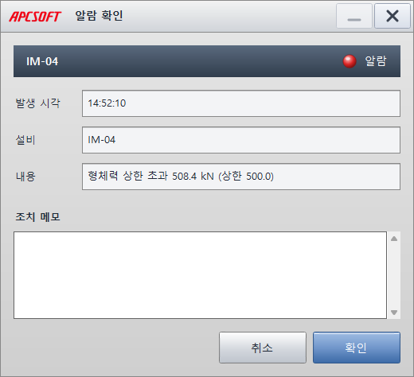

# 최종 시연 A — 사출 성형 라인 모니터링 (MoldingLineMonitor)

> 완성된 스킬로 1~5회차 A 프롬프트를 변형해 시연했다. 보고 본문은 Sonnet 서브에이전트가 돌려준 것을 메인 세션이 저장했다.

## 프롬프트

```
사출 성형 라인 모니터링 프로그램 만들어줘. 프로젝트명 MoldingLineMonitor, 고객사 default.
메인 화면: 사출기 8대(IM-01~IM-08) 상태 타일, 선택 설비의 금형 온도·사출 압력·형체력(kN)·사이클 타임 현재값 카드, 선택 설비 사출 압력 추이 그래프, 금일 생산 수량·불량률, 최근 알람 이력 표.
dialog: 레시피 편집(금형 온도 설정값, 사출 압력 상한, 형체력 상한, 사이클 타임 목표), 알람 확인(알람 한 건 상세 + 조치 메모 입력).
```

1~5회차와 다른 점은 다음과 같다.
- 사출기를 6대에서 8대로 늘렸다.
- 형체력 카드, 금일 생산·불량률, 알람 확인 dialog를 추가했다.
- 추이 그래프 항목을 금형 온도에서 사출 압력으로 바꿨다.

## 1. 진행 과정 요약

- **템플릿:** `EquipmentView`, `RecipeDialog`를 썼다. 알람 확인 dialog는 `RecipeDialog` 입력 폼에 `ApcHeaderBar` 상태 줄을 더해 만들었다.
- **render 1회차:** 타일 3개의 문구가 말줄임으로 잘렸다(필요 177px > 폭 149px). 타일 8개를 4개씩 2줄로 나눴다.
- **render 2회차:** 표 세로 스크롤바 점검이 나왔다. 이력을 10행으로 줄였다.
- **render 3회차:** 세 화면 모두 `점검 0건`이었다.
- **눈 확인:** 고친 것은 없다.

## 2. 결과 화면



- 타일은 4×2이고, 선택 설비는 IM-04다.
- 카드 6장: IM-04 측정값 4장과 금일 생산·불량률 2장.
- 사출 압력 추이, 이력 10행, 알람바가 있다.
- 헤더 요약은 "전체 · 알람 1 · 경고 2 · 정지 1 · 통신 끊김 1"이다.





## 3. 빌드/render 최종 결과

| 항목 | 결과 |
|---|---|
| 빌드 | 경고 0, 오류 0 |
| MainForm / RecipeDialog / AlarmConfirmDialog | 점검 0건 / 0건 / 0건 |

## 4. 정한 기준값

| 항목 | 하한 | 하한 경고 | 상한 경고 | 상한 | 설정·목표 |
|---|---|---|---|---|---|
| 금형 온도 ℃ | 55.0 | 57.0 이하 | 63.0 이상 | 65.0 | 설정 60.0 |
| 사출 압력 bar | 110.0 | 115.0 이하 | 140.0 이상 | 150.0 | 기준선 130.0 |
| 형체력 kN | 400.0 | 420.0 이하 | 480.0 이상 | 500.0 | 상한 500.0 |
| 사이클 타임 s | — | — | 26.0 이상 | 28.0 | 목표 24 |

## 5. 스킬 피드백 (에이전트 보고)

1. 대기·통신 끊김 설비의 추이 그래프를 어떻게 그릴지 정해져 있지 않다.
2. 정지 설비가 읽은 값을 보여 주는 부분은 추측했다.
3. 타일이 8개 이상일 때 2줄로 나누라는 안내가 없다. render 점검을 보고 알았다.
4. 선택 행이 없을 때 버튼을 누르면 아무 반응이 없는데, Alert를 띄워도 되는지 불명확하다.
5. 제목과 버튼을 한 줄에 둘 때 세로 정렬이 약간 어긋난다.
6. 대기·통신 끊김이 들어간 헤더 요약 문구의 예시가 없다.
7. 알람 이력에 정지·정보 이벤트를 넣어도 되는지 범위가 불명확하다.
8. "정상 복귀" 문구에도 같은 판정 함수를 써야 하는지 불명확하다.
9. 그래프 줄 높이와 점 개수는 짐작했다.
10. 도구 오작동은 없었다.

## 메인 세션 확인

- PNG에서 규칙 위반은 보이지 않았다.
- 선택 타일, 경계값("150.0 (상한 150.0)" 경고), 이력 시각 순서(13:41 알람 → 13:52 복귀), 헤더 순서, 기준값 자리수가 모두 맞다.
- 타일 문구 잘림은 render 점검이 먼저 잡아 에이전트가 고쳤다.
