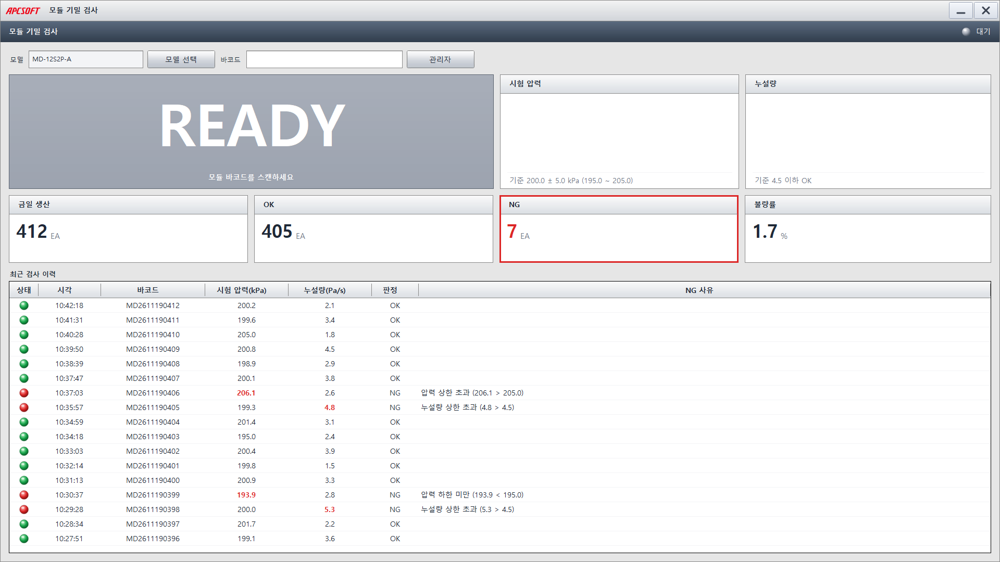
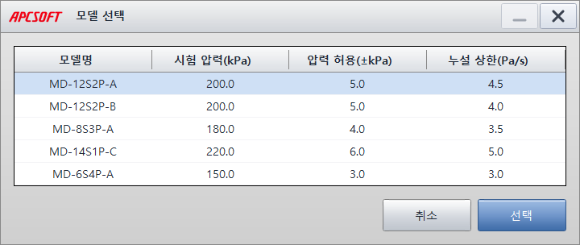

# 최종 시연 B — 2차전지 모듈 기밀 검사기 (ModuleLeakTester)

> 완성된 스킬로 1~5회차 B 프롬프트를 변형해 시연했다. Sonnet 서브에이전트가 돌려준 보고 본문을 메인 세션이 저장했다.

## 프롬프트

```
2차전지 모듈 기밀 검사기 현장 프로그램 만들어줘. 프로젝트명 ModuleLeakTester, 고객사 default.
메인 화면: 모듈 바코드 스캔 입력, 시험 압력(kPa) 현재값(기준 200.0 ±5.0 kPa), 누설량(Pa/s) 현재값(상한 4.5 Pa/s), 최종 판정(OK/NG) 크게, 금일 생산·NG·불량률, 최근 검사 이력 표(시각, 바코드, 시험 압력, 누설량, 판정, NG 사유).
dialog: 모델 선택(모델 목록 표 + 선택), 관리자 비밀번호.
```

변형한 점: 셀 → 모듈, 측정값 2개(시험 압력 범위 판정 추가), 스캔 입력, NG 사유 열, 모델 선택 dialog.

## 1. 진행 과정 요약

- **템플릿:** 메인은 `JudgeView`, 비밀번호는 `AdminPasswordDialog`를 썼다. 모델 선택은 맞는 템플릿이 없어 `ApcGrid` + `AddContent` + `SetFooter`로 새로 짰다.
- **소스 작성:** 모두 Write로 썼고 heredoc은 쓰지 않았다.
- **render (2회)**
  - 1회차: MainForm에서 `점검 1건`(표 세로 스크롤바)이 나왔다. 이력을 17행으로 줄였다.
  - 2회차: 세 화면 모두 `점검 0건`이었다.
- **눈 확인:** 고친 것은 없다.

## 2. 결과 화면



- **헤더:** 대기(READY) 상태라 헤더는 "대기", 측정 카드 값은 빈칸이다.
- **이력 경계값:** 205.0 kPa, 195.0 kPa, 4.5 Pa/s 행은 모두 OK로 판정됐다.
- **NG 행:** 이탈 값은 빨간 굵은 글씨이고, NG 사유 열에 "압력 상한 초과 (206.1 > 205.0)" 같은 문구가 들어간다.



모델 목록 표가 있고, 현재 모델 행이 선택돼 있다. 아래에 [취소][선택] 버튼이 있다.


## 3. 빌드/render 최종 결과

| 항목 | 결과 |
|---|---|
| 빌드 | 경고 0, 오류 0 |
| MainForm / ModelSelectDialog / AdminPasswordDialog | 점검 0건 / 0건 / 0건 (참고 줄 없음) |

## 4. 정한 기준값

| 항목 | 값 | 비고 |
|---|---|---|
| 시험 압력 | 200.0 ± 5.0 kPa | 요구서 |
| 누설량 상한 | 4.5 Pa/s | 요구서 |
| 경고 구간 | 없음 | |
| 나머지 4개 모델의 기준값 | 예시 값 | 에이전트가 정함 |
| 소수 자리 | kPa·Pa/s·불량률 `0.0` | |

NG 사유 문구 형식과 "압력 사유 우선" 순서는 에이전트가 정했다.

## 5. 스킬 피드백 (에이전트 보고)

1. 4b 표에 "목록 표에서 고르는 dialog" 유형이 없어서 조합해 만들었다. 직접 정한 것: `ClearInitialSelection=false`, 더블클릭으로 선택, Enter = 선택 버튼.
2. 4a의 "표 행 선택"과 4c의 "입력 표"가 같은 설정(`ClearInitialSelection=false`)을 쓴다. 둘의 관계가 명시돼 있지 않다.
3. 대기 상태에서 측정 카드가 빈 상자로 보인다. 규칙대로 한 것이다.
4. 대기 중 집계 카드의 Status를 Run으로 할지 Stop으로 할지 모호하다.
5. 이력 판정이 어느 모델 기준인지 규칙이 없다. 이번에는 행마다 그 검사 때의 모델을 따르게 했다.
6. Fill이 아닌 열의 고정 폭과, 긴 글 열 헤더의 정렬 기준이 없다.
7. 도구 오작동은 없었다.

## 메인 세션 확인

- PNG 3장에서 규칙 위반은 보이지 않았다.
- 이전 회차에 반영한 규칙이 처음 보는 화면 구성에서도 지켜졌다: 경계값 OK, 이탈 셀 강조, 램프 열 + 판정 글 열, 헤더 "대기".
