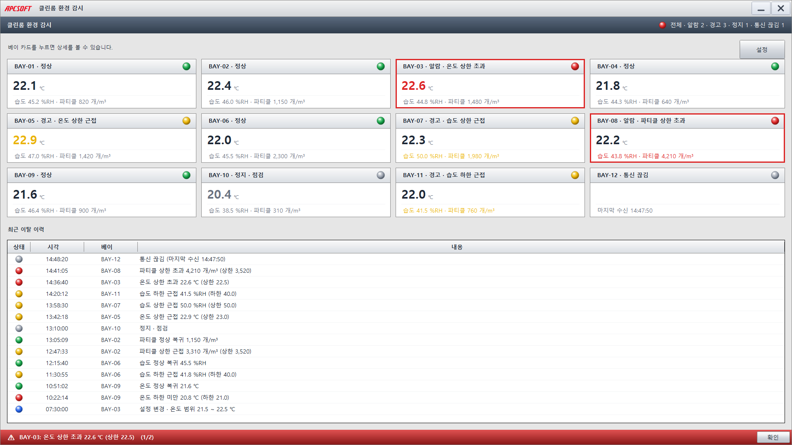
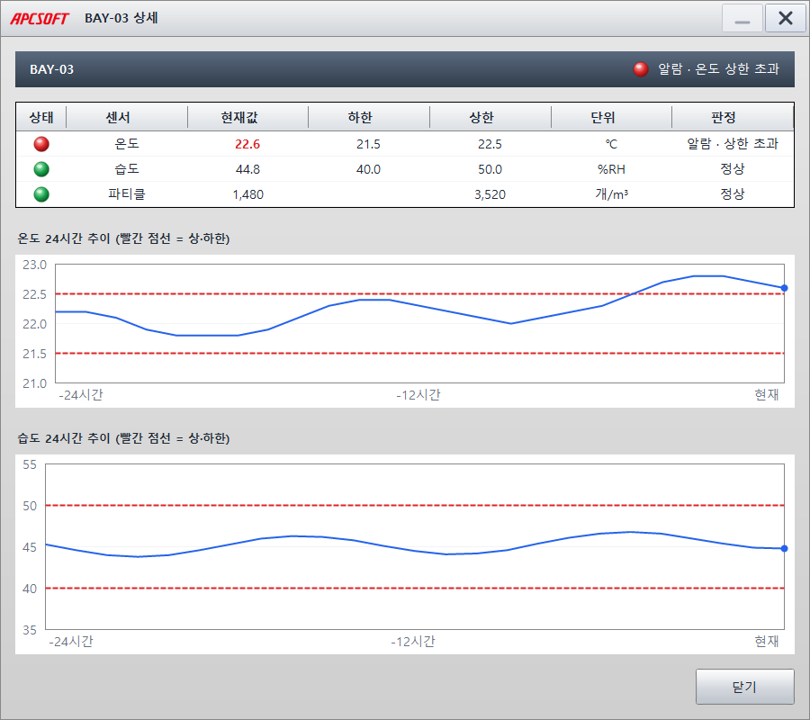
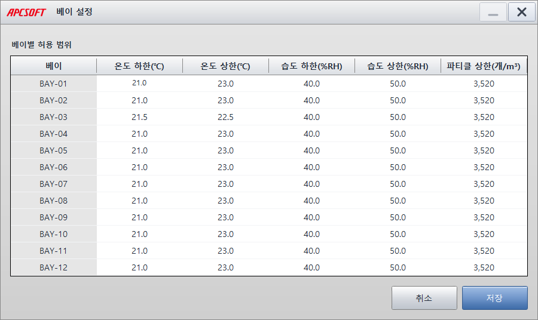

# 최종 시연 C — 반도체 클린룸 환경 감시 (FabEnvMonitor)

> 완성된 스킬로 1~5회차 C 프롬프트를 변형해 시연했다. Sonnet 서브에이전트가 보고 본문을 반환했고, 메인 세션이 그 본문을 이 파일로 저장했다.

## 프롬프트

```
반도체 클린룸 환경 감시 프로그램 만들어줘. 프로젝트명 FabEnvMonitor, 고객사 default.
메인 화면: 베이 12곳(BAY-01~BAY-12)을 센서 카드 격자로(온도·습도 현재값, 파티클은 카드 Footer), 기준 이탈 베이 강조, 헤더에 알람·경고 베이 수, 하단 최근 이탈 이력 표.
dialog: 베이 상세(베이 클릭 시 온도·습도 24시간 추이 + 센서 표), 설정(베이별 온도·습도 상하한, 파티클 상한).
```

이전 회차와 달라진 점: 표가 아니라 카드 격자 12장이고, 이탈 이력 표와 베이 상세 dialog가 추가됐다.

## 1. 진행 과정 요약

- **참고한 템플릿:** `TempHumiView`, `EquipmentView`, `EquipmentDetailDialog`, `LotInputDialog`(입력 표)
- **메인 화면:** `Columns()`로 4×3 카드 격자를 짜고 그 아래에 이력 표를 두었다.
- **render 1회차:** `점검 1건`(표 세로 스크롤바, 행 16 중 14행 보임). 이력을 14행으로 줄였다.
- **render 2회차:** 세 화면 모두 `점검 0건`이었다.
- **눈 확인:** 고친 것은 없다. 에이전트가 한계로 본 것이 2건 있다(5번 참고).

## 2. 결과 화면



- **헤더:** "전체 · 알람 2 · 경고 3 · 정지 1 · 통신 끊김 1"
- **카드 제목 띠:** "BAY-03 · 알람 · 온도 상한 초과"처럼 상태 문구를 넣었다.
- **정지 베이(BAY-10):** 값을 판정하지 않고 회색으로 보인다.
- **경계값:** 습도 50.0(상한과 같은 값)이 경고로 나온다.





## 3. 빌드/render 최종 결과

| 항목 | 결과 |
|---|---|
| 빌드 | 경고 0, 오류 0 |
| MainForm / BayDetailDialog / BaySettingsDialog | 점검 0건 / 0건 / 0건 |

## 4. 정한 기준값

| 항목 | 기준 |
|---|---|
| 온도 | 21.0~23.0 ℃, 경고 폭 0.3. BAY-03만 21.5~22.5 ℃ |
| 습도 | 40.0~50.0 %RH, 경고 폭 2.0 |
| 파티클 | 상한 3,520 개/m³(ISO 5), 3,000부터 경고 |

## 5. 스킬 피드백 (에이전트 보고)

1. **값 3개 카드의 Footer 색:** 카드에 값이 3개면 Footer에 습도와 파티클이 함께 들어가는데, `FooterStatus`는 하나뿐이다. 그래서 BAY-08은 정상인 습도 43.8까지 빨갛게 칠해졌다.
2. **카드 상태 문구 위치:** 규칙이 없어서 제목 띠에 넣었다.
3. **`AddContent` 높이:** 그래프 높이를 `ApcTheme.Px(170)`처럼 직접 줬다. 4b의 "숫자로 정하지 않는다"와 충돌해 보인다.
4. **설정 dialog 첫 칸:** 편집 상태로 시작한 첫 칸의 글자가 다른 칸보다 작고 위쪽에 그려진다.
5. 도구 오작동은 없었다.

## 메인 세션 확인

PNG에서 1번과 4번을 확인했다. 둘 다 규칙이 아니라 **라이브러리 쪽 한계**다. 다음 작업 후보로 정리했다(`final/SUMMARY.md` 참고).
