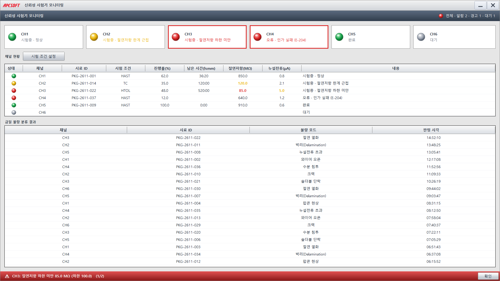
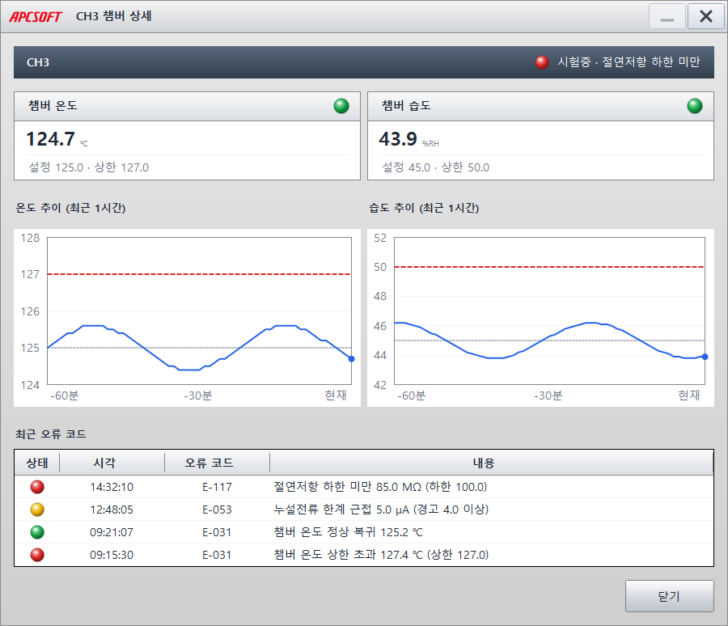
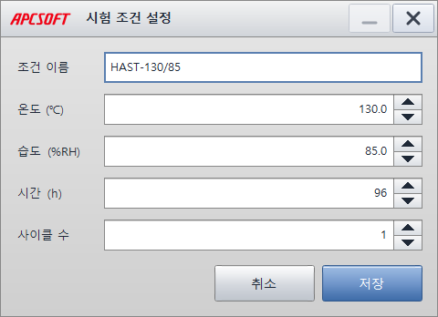

# 최종 시연 D — 반도체 패키지 신뢰성 시험기 (ReliabilityTester)

> 완성된 스킬로 1~5회차 D 프롬프트를 변형해 시연했다. Sonnet 서브에이전트가 보고 본문을 반환했고, 메인 세션이 그 본문을 저장했다.

## 프롬프트

```
반도체 패키지 신뢰성 시험기 현장 프로그램 만들어줘. 프로젝트명 ReliabilityTester, 고객사 default.
메인 화면: 시험 챔버 6개(CH1~CH6)별 상태(시험중/완료/오류/대기)와 진행률·남은 시간, 시료 ID·시험 조건(HAST/TC/HTOL), 채널별 절연저항(MΩ)·누설전류(µA) 현재값, 금일 불량 분류 결과 표(시료 ID, 불량 모드, 판정 시각).
dialog: 챔버 상세(챔버 온도·습도 추이 + 최근 오류 코드), 시험 조건 설정(조건 이름, 온도, 습도, 시간(h), 사이클 수).
```

이전 회차와 달라진 점:
- 채널 4개 → 6개
- 남은 시간 추가
- 측정값 단위 MΩ·µA
- 시험 조건 설정 dialog 추가

## 1. 진행 과정 요약

- **템플릿:** 세 템플릿의 구조를 참고했다.
  - 메인 화면: `EquipmentView`. 6채널 × 5항목이라 카드 대신 채널 현황 표로 만들었다.
  - 챔버 상세 dialog: `EquipmentDetailDialog`
  - 시험 조건 설정 dialog: `RecipeDialog`
- **render 1회차:** 세 화면 모두 `점검 0건`. 참고 줄 1개("표 아래가 빔")가 나와 불량 표를 18행으로 늘렸다. 이때 겹치는 시료 ID를 직접 찾아 고쳤다.
- **눈 확인으로 고친 것 1건:** 상세 dialog 추이의 마지막 점이 갑자기 튀어 보였다. 곡선이 현재값에서 자연스럽게 끝나도록 바꿨다.
- **render 2회차:** 세 화면 모두 `점검 0건`. 참고 줄도 없었다.

## 2. 결과 화면



- 헤더: "전체 · 알람 2 · 경고 1 · 대기 1"
- 타일 6개, 채널 현황 표, 불량 표 18행, 알람바(1/2)
- CH4는 오류 상태다. 읽은 값은 판정하지 않고 기본 글자색으로 보인다.



- 온도·습도 카드, 그래프 2개, 최근 오류 코드 표 4행



## 3. 빌드/render 최종 결과

| 항목 | 결과 |
|---|---|
| 빌드 | 경고 0, 오류 0 |
| MainForm | 점검 0건 |
| ChamberDetailDialog | 점검 0건 |
| TestConditionDialog | 점검 0건 |

## 4. 정한 기준값

- 절연저항: 하한 100.0 MΩ, 120.0 이하부터 경고
- 누설전류: 상한 5.0 µA, 4.0 이상부터 경고
- 값 판정은 "시험중" 채널에만 한다.
- 소수 자리: MΩ·µA·진행률은 `0.0`. 남은 시간은 h:mm.
- 챔버 설정값·상한, dialog 입력 범위도 에이전트가 정했다.

## 5. 스킬 피드백 (에이전트 보고)

1. MΩ의 소수 자리가 4-1 표에 없다. 질문 금지 조건이라 `0.0`으로 정했다.
2. "오류" 상태 설비가 읽은 값을 판정할지 규칙이 없다. 정지·대기와 같이 판정하지 않는 쪽으로 정했다.
3. 헤더 요약에서 "완료"를 정상으로 세는지 규칙에 없다.
4. dialog를 여는 일반 버튼의 위치 규칙이 없다.
5. `Columns(S(높이), …)`에 이미 배율이 적용된 `HeightForRows()`를 그대로 넘겨도 되는지 문서에 없다.
6. dialog에서 그래프를 `AddContentRow`로 나란히 놓는 예시가 없다(동작은 했다).
7. 도구 오작동은 없었다.

## 메인 세션 확인

- PNG에서 규칙 위반은 보이지 않았다.
- 5회차에 바꾼 "멈춘 설비 값은 판정하지 않음" 규칙이 오류 채널(CH4)에도 일관되게 적용됐다.
- 경계값 표시: 누설전류 5.0은 상한과 같은 값이라 경고, 절연저항 120.0은 경고 시작값이라 경고로 나온다.
