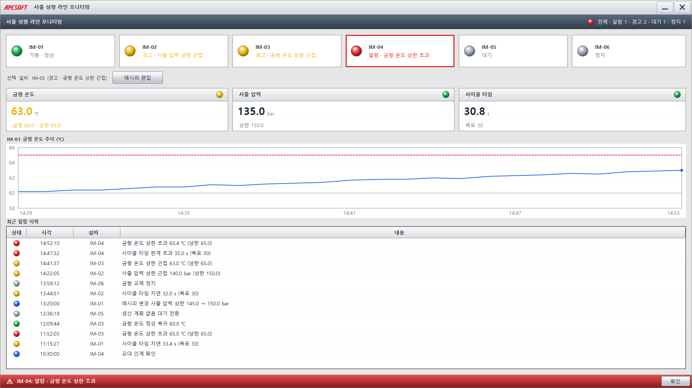
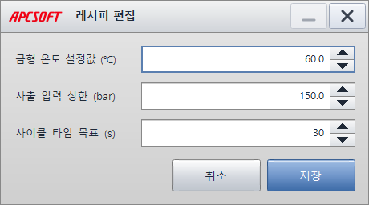

# 시연 A — 사출 성형 라인 모니터링 (InjectionMonitor)

> 서브에이전트(Sonnet)가 시연을 수행했고 REPORT.md 경로를 보고했으나 파일이 생성되지 않아, 에이전트 반환 내용과 PNG 확인 결과로 메인 세션이 작성했다.

## 1. 프롬프트

```
사출 성형 라인 모니터링 현장 PC 프로그램 만들어줘. 프로젝트명 InjectionMonitor, 고객사 default.
메인 화면: 사출기 6대(IM-01~IM-06) 상태 타일(가동/대기/알람/정지), 선택 설비의 금형 온도·사출 압력·사이클 타임 현재값 카드, 금형 온도 추이 그래프, 최근 알람 이력 표.
dialog: 레시피 편집(금형 온도 설정값, 사출 압력 상한, 사이클 타임 목표).
```

## 2. 진행 과정 요약

- 스킬 절차대로 `new-project.sh` → `docs/api.md` → 배치 → 데이터 자리 → 완료 확인.
- render 3회: MainForm 1회차 점검 1건(표 세로 스크롤바) → 샘플 행 13 → 12로 줄여 0건. RecipeDialog는 처음부터 0건.
- `new-project.sh`, env.sh/MSBuild, render 모두 정상 동작.

## 3. 결과 화면



사출기 6대 상태 타일(가동·경고·알람·대기·정지), 선택 설비 IM-03의 금형 온도·사출 압력·사이클 타임 카드, 금형 온도 추이(상한선 65.0), 알람 이력 12행, 하단 알람바(IM-04 금형 온도 상한 초과).



금형 온도 설정값·사출 압력 상한·사이클 타임 목표 3칸, [취소][저장].

## 4. 빌드/render 최종 결과

| 항목 | 결과 |
|---|---|
| 빌드 | 경고 0, 오류 0 |
| MainForm | 점검 0건 |
| RecipeDialog | 점검 0건 |

## 5. 스킬 피드백

에이전트 보고 — SKILL.md 모순·오류, 도구 오류 없음. 짐작한 부분:
1. 압력 단위 bar 선택(요구서에 없음).
2. 사이클 타임 목표는 정수 30 s, 측정값은 30.8 s라 같은 항목이 자릿수가 달라 보임(4-1 규칙대로지만 의도 설명 없음).
3. 헤더 요약에서 대기/정지를 따로 셀지 규칙 없음.
4. 정지 설비 카드 Status를 Stop으로 할지 규칙 없음.
5. 한 설비에 여러 값이 동시에 경고일 때 타일 문구 우선순위 규칙 없음.

메인 세션 PNG 확인 — 도구가 못 잡은 것:
6. **선택 설비 표시 없음** — 선택 설비는 IM-03인데 타일에 선택 강조가 없다(빨간 테두리는 알람인 IM-04).
7. **경계값 문구 모순** — 이력 11:52:03 "금형 온도 상한 초과 65.0 ℃ (상한 65.0)": 상한과 같은 값을 "초과"로 표기.
8. 헤더 요약 앞의 "전체 ·" 접두가 의미 없이 붙음(C도 동일).
9. 메인 카드는 "설정 60.0 · 상한 65.0"인데 레시피 dialog에 금형 온도 상한 칸이 없어 상한 출처가 화면에 없다.
