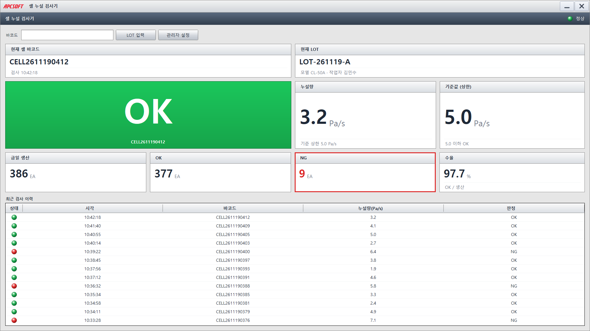
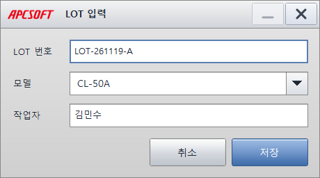

# CellLeakTester 시연 보고서 (apc-field-ui 스킬)

## 1. 프롬프트
```
2차전지 셀 누설 검사기 현장 프로그램 만들어줘. 프로젝트명 CellLeakTester, 고객사 default.
메인 화면: 현재 셀 바코드·LOT, 누설량(Pa/s) 현재값과 판정(OK/NG) 크게, 기준값(상한 5.0 Pa/s), 오늘 생산 수량·NG 수량·수율, 최근 검사 이력 표(시각, 바코드, 누설량, 판정).
dialog: LOT 입력(LOT 번호, 모델, 작업자), 관리자 비밀번호.
```

## 2. 진행 과정 요약
- 스킬 1단계: 필수 입력(목적=공정 설비 판정, 메인 기능, dialog)이 모두 있어 질문 없이 진행. 고객사 default 사용.
- 2단계: `new-project.sh skill-test/B-cellleak/project CellLeakTester default` 실행(신규 프로젝트, v4.0).
- 3단계: `docs/api.md`와 템플릿 `JudgeView`(메인), `RecipeDialog`(LOT 입력의 입력 폼 구조), `AdminPasswordDialog`(관리자 비밀번호), `LotInputDialog`(템플릿은 칸별 스캔 표라 이 요청과 맞지 않아 참고만 함)를 읽음.
- 4단계: 메인은 JudgeView 구조(도구 줄 → 판정판+값 카드 → 집계 카드 4 → 이력 표)로 새 `MainView`에 작성. 현재 셀 바코드·LOT 카드 줄을 추가. 샘플 데이터는 `SampleMainViewSource`, 모델은 `IMainViewSource`(LeakLimit, GetLot/SetLot, GetToday, GetHistory, Inspect). 경계값 5.0 Pa/s 행은 OK(판정 함수 하나 `InspectionRecord.Judge`, `<=`).
- 모든 `.cs`는 Write 도구로 작성(heredoc 사용 안 함).
- render 반복: 2회. 1회차 `점검 1건`("표 세로 스크롤바(행 17 중 13행 보임)") → 샘플 이력을 13행으로 줄여 해결 → 2회차 3개 화면 모두 `점검 0건`.
- PNG를 Read로 열어 확인: 상태가 글자(OK/NG, 판정 열)로도 보임, 집계 정합(생산 386 = OK 377 + NG 9, 수율 97.7%), 큰 빈 공간 없음.

## 3. 결과 화면

메인 화면(1920x1080): 스캔·LOT 입력·관리자 설정 버튼, 현재 바코드/LOT 카드, 큰 OK 판정판, 누설량 3.2 Pa/s, 기준값 5.0 Pa/s, 금일 집계(생산·OK·NG·수율), 최근 검사 이력 13행(경계값 5.0 OK 행, NG 3건 포함).


LOT 입력 dialog: LOT 번호·모델(콤보)·작업자, [취소][저장]. 저장 시 검증 Alert → 저장 확인 → 결과 속성.


관리자 비밀번호 dialog: 마스킹 입력칸, [취소][확인], Enter = 확인.

## 4. 빌드/render 최종 결과
- 빌드: 경고 0개, 오류 0개.
- render 점검: MainForm 0건, LotInputDialog 0건, AdminPasswordDialog 0건.

## 5. 스킬 피드백
- 도구 오작동·SKILL.md 오류: 없음. 스킬 지시대로 진행해 막힘 없었다.
- 애매했던 점(추측한 것):
  1. `ApcTemplateView`에 `Control.Refresh()`를 가리는 이름(`Refresh`)을 쓰면 경고가 날 수 있음. 처음부터 `Apply`로 이름을 지어 피했지만(sed로 변경) SKILL.md에 "Refresh/Show 등 Control 멤버 이름 피하기" 한 줄이 있으면 좋다.
  2. 관리자 비밀번호 확인 후 동작(설정 화면 진입)이 요구에 없어, 입력 여부만 확인하고 Alert를 띄우는 자리로 둠. 비밀번호 검증 위치(데이터 자리 인터페이스에 둘지)는 스킬에 지침이 없어 추측.
  3. "LOT 입력" dialog 요구가 템플릿 표의 `LotInputDialog`(칸별 스캔 표)와 의미가 달라 `RecipeDialog` 구조를 썼다. 템플릿 이름이 같아 혼동 여지 있음(표에 "단일 LOT 폼은 RecipeDialog" 같은 안내 제안).
  4. 판정 화면에서 누설량 카드의 대기 상태 `Footer` 출처 규칙은 현재 값이 항상 있어 해당 없었음. 헤더 요약은 NG 시 "NG 발생"(템플릿 따름)으로 했고 "알람 1" 식 요약 규칙과 충돌 여지가 있어 현재 셀이 OK인 샘플만 사용.
  5. 빌드 시간이 0.5초로 매우 짧게 나옴(정상 빌드였음, 문제 아님).
