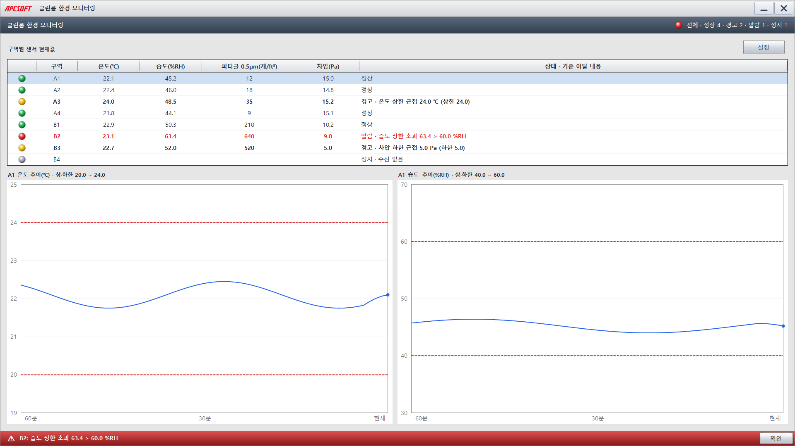
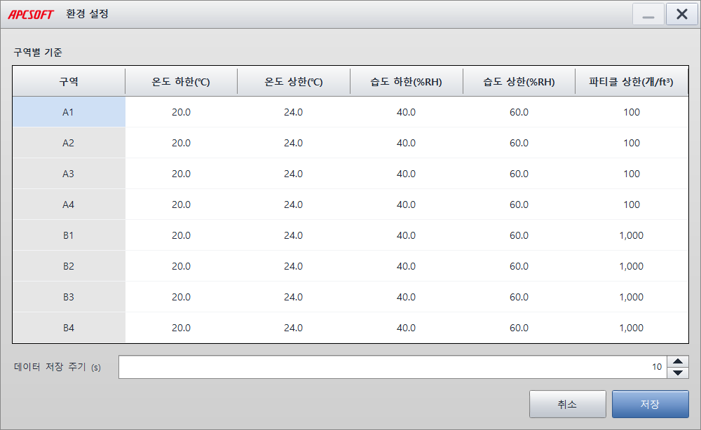

# 시연 C — 클린룸 환경 모니터링 (CleanroomMonitor)

> 서브에이전트(Sonnet)가 시연을 수행했으나 보고서 파일 쓰기가 하네스 정책으로 거부되어, 에이전트가 반환한 본문을 메인 세션이 저장했다.

## 1. 프롬프트

```
클린룸 환경 모니터링 프로그램 만들어줘. 프로젝트명 CleanroomMonitor, 고객사 default.
메인 화면: 구역 8곳(A1~A4, B1~B4)의 온도·습도·파티클(0.5µm, 개/ft³)·차압(Pa) 센서 목록 표, 기준 이탈 구역 강조, 선택 구역 온습도 추이 그래프, 헤더에 전체 정상/경고/알람 구역 수 요약.
dialog: 설정(구역별 온도·습도 상하한, 파티클 상한, 데이터 저장 주기).
```

## 2. 진행 과정 요약

- 스킬 호출 → 1단계(입력 3종 있음, 고객사 default) → 2단계 `new-project.sh`(알림 없음) → 3단계 `docs/api.md` → 4단계 배치 → 6 → 7.
- 메인 화면: `TempHumiView`(센서 카드 격자)를 참고했으나 8구역 표 + 추이가 요구라 `ApcTemplateView` 위에 `ApcGrid` + `ApcLampColumn` + `ApcTrendChart` 2개(온도·습도)로 새 배치. 판정 함수 `ZoneJudge` 하나를 표 램프·상태 문구·헤더 요약·알람바가 공유. 경계값(온도 = 상한 24.0, 차압 = 하한 5.0)은 경고 처리.
- 설정 dialog: `LotInputDialog`의 입력 표 + `RecipeDialog`의 저장 흐름(검증 Alert → Confirm "저장" → 결과 속성 → OK)을 합쳐 `SettingsDialog`로 작성.
- 샘플 상태: 정상 4, 경고 2(A3 온도 경계값, B3 차압 경계값), 알람 1(B2 습도 초과), 정지 1(B4 통신 끊김).
- render: 메인 2회, dialog 1회. 처음부터 `점검 0건`. 눈 확인으로 고친 것: 상태 문구 "정상 · 정상" 중복 → "정상", 설정 버튼만 있던 빈 줄을 표 제목 줄에 합침.
- 존재하지 않는 `Alarm.AcknowledgeAll`을 썼다가 api.md 재확인 후 빌드 전에 수정.

## 3. 결과 화면



헤더 요약 "전체 · 정상 4 · 경고 2 · 알람 1 · 정지 1". 구역 8행 표 — 경고·알람 행은 굵게, 알람은 빨강 글자, 램프 + 글 문구 병행. 선택 구역(A1) 온도·습도 추이에 상·하한선, 하단 알람바에 B2 알람.



구역별 온도·습도 상하한, 파티클 상한을 입력 표에서 직접 편집(구역 열은 회색 읽기 전용). 아래에 데이터 저장 주기(s), 오른쪽 아래 [취소][저장].

## 4. 빌드/render 최종 결과

| 항목 | 결과 |
|---|---|
| 빌드 | 경고 0, 오류 0 |
| MainForm | 점검 0건 |
| SettingsDialog | 점검 0건 |

## 5. 스킬 피드백

1. **헤더 요약 규칙 vs 요청 충돌** — SKILL.md는 "정상 외 상태만 센다(모두 정상이면 '정상')", 프롬프트는 정상/경고/알람 수를 요청. 요청을 우선해 정상 수도 넣었다. 요구서 우선 예외가 헤더 요약 항목에 명시돼 있지 않다.
2. **경계값 규칙과 샘플 예시가 어긋나 보임** — 4-1은 "상·하한과 같은 값은 그 상태에 넣는다(`>=`/`<=`)"인데 샘플 예시는 "기준 5.0 Pa → 5.0 Pa OK". 한계와 같음 = 경고, 초과 = 알람으로 짐작.
3. 하한만 있고 구역별 설정 대상이 아닌 기준값(차압)의 위치 안내 없음 → 상수 `ZoneJudge.PressureMin`.
4. `ApcAlarmBar`에 전체 지우기 없음 → `while (Alarm.Count > 0) AcknowledgeCurrent()`. 설정 변경 후 재판정·알람 재등록 패턴 안내 없음.
5. 구역 8행 × 여러 값 설정은 `AddFieldRow`로 비효율이라 입력 표 사용. 숫자 검증·서식 정규화(`CellEndEdit`) 가이드 없음. 4b "숫자를 직접 정하지 않는다"와 달리 행·헤더 높이를 `ApcTheme.Px(44)`로 직접 지정.
6. 표 높이 계산식(`MinHeight * 1.15 + MinHeight * 행수 + 2`)이 SKILL.md에 없고 `EquipmentDetailDialog` 템플릿을 읽어야 알 수 있다.
7. 정지 구역(B4) 선택 시 `SetValues(빈 배열)` render 결과는 미확인(render 기본 선택은 A1).
8. 도구 오작동·오류 메시지 없음. 점검이 처음부터 0건이라 엄격성은 판단 불가. 중복 문구·빈 줄은 도구가 못 잡음.
9. 사소: 차트 제목 "A1 습도 추이"의 글자 간격이 벌어져 보임(원인 미조사).
