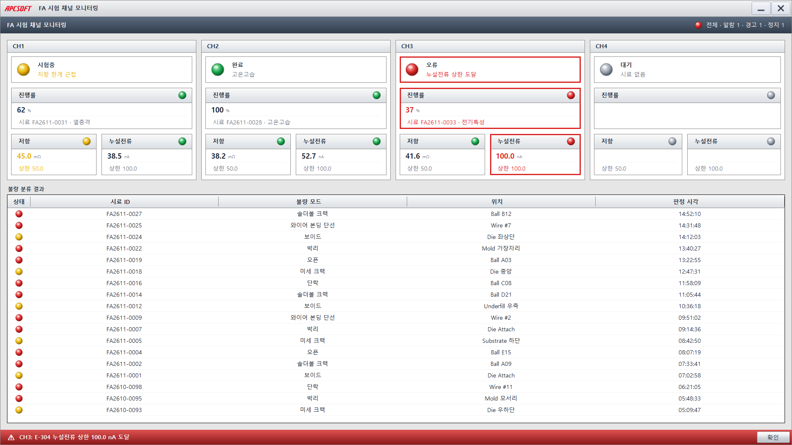
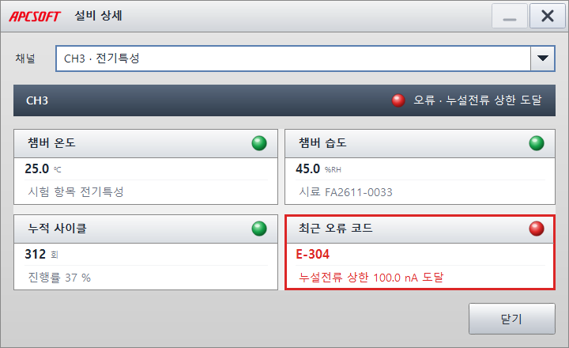

# 시연 D — 반도체 패키지 FA 시험기 (FATester)

> 서브에이전트(Sonnet)가 시연을 수행했으나 보고서 파일 쓰기가 하네스 정책으로 거부되어, 에이전트가 반환한 본문을 메인 세션이 저장했다(PNG 확인 소견 추가).

## 1. 프롬프트

```
반도체 패키지 Failure Analysis 시험기 현장 프로그램 만들어줘. 프로젝트명 FATester, 고객사 default.
메인 화면: 시험 채널 4개(CH1~CH4)별 진행 상태(시험중/완료/오류/대기)와 진행률, 현재 시료 ID·시험 항목(열충격/고온고습/전기특성), 채널별 측정값(저항 mΩ, 누설전류 nA) 현재값, 불량 분류 결과 표(시료 ID, 불량 모드, 위치, 판정 시각).
dialog: 설비 상세(채널 선택 시 챔버 온도·습도·누적 사이클·최근 오류 코드).
```

## 2. 진행 과정 요약

- 입력 모두 있음 → 질문 없이 진행(고객사 default). `new-project.sh` → `docs/api.md`. `.cs`는 모두 Write 도구로 작성(heredoc 미사용).
- 메인: 맞는 템플릿이 없어 `ApcTemplateView` 위에 새 배치. 채널 4칸 = `Columns` + `ApcGroup`, 각 칸은 `ApcStatusTile` + 진행률 `ApcValueCard` + 저항·누설전류 `ApcValueCard`. 아래 `ApcGrid` 불량표. `EquipmentView`·`EquipmentDetailDialog`는 구조 참고.
- dialog: `ApcForm` 상속 `ChannelDetailDialog` — `SetupDialog`, `AddFieldRow`(채널 `ApcComboBox`), `AddContent`(`ApcHeaderBar`), `AddContentFill`(카드 2×2), `SetFooter(null, 닫기)`. 타일 클릭으로 열림, 콤보 변경 시 갱신.
- 데이터: `IMainViewSource`(GetChannels, GetDefects) + `SampleMainViewSource`. 판정 함수 `Limits.Judge`(상한 이상 = 알람, 상한 90% 이상 = 경고)를 타일·카드·dialog가 공유.
- 경계값 샘플: 저항 45.0 mΩ(상한 50.0의 90%, 경고), 누설전류 100.0 nA(상한과 같음, 알람).
- render 6회:
  1. MainForm 점검 4건("부모 밖으로 넘침", 채널 그룹 높이 부족) → 그룹 높이 S(330)→S(372). dialog 1건("하단 버튼 위 빈 공간 28px").
  2. 28px 점검은 카드 높이 축소·`AddContentFill` 전환으로도 안 없어짐. 원인은 카드 기본 `Margin` 3px → Margin을 `ApcLayout.ItemGap`/`RowGap` 기준으로 지정해 0건.
  3. PNG 눈 확인 수정: CH4(대기)에 "저항 한계 근접"이 찍히는 버그(값 없음이 `Stop`으로 판정), 타일·그룹 제목 중복, 그룹 아래 빈 공간(S(340)), 표 행 18행(render 참고 수), dialog 위 줄 카드 값 글자 작게 그려짐(Margin 위아래 반분, 위 줄 카드에 Footer 추가).

## 3. 결과 화면



채널 4칸(시험중·완료·오류·대기)과 불량 분류 결과 표 18행. 헤더 "전체 · 알람 1 · 경고 1 · 정지 1", 알람바 "CH3: E-304 누설전류 상한 100.0 nA 도달".



CH3 선택 상태. 챔버 온도·습도, 누적 사이클, 최근 오류 코드 E-304(알람색).

## 4. 빌드/render 최종 결과

| 항목 | 결과 |
|---|---|
| 빌드 | 경고 0, 오류 0 |
| MainForm | 점검 0건 (참고 없음) |
| ChannelDetailDialog | 점검 0건 |

## 5. 스킬 피드백

에이전트 보고:
1. **dialog 28px 점검의 원인 안내 부족** — 메시지는 "SetupDialog 높이 0(자동) 또는 AddContentFill"만 제시, 이미 자동 높이인 경우 무용. 실제 원인은 `AddContent`한 자체 `TableLayoutPanel` 자식의 기본 `Margin` 3px. 시행착오 3회. 4b에 "자체 컨테이너를 `AddContent`할 때 자식 `Margin`은 0, 간격은 `ApcLayout` 상수" 한 줄 필요.
2. **dialog용 카드 격자 헬퍼 없음** — `Columns()`는 `ApcTemplateView` 전용이라 `TableLayoutPanel` 퍼센트·Margin을 직접 계산. "숫자로 정하지 않는다" 원칙과 충돌. `AddCardRow` 헬퍼 후보.
3. **`ApcValueCard` 값 글자 크기가 카드 높이에 따라 달라짐** — 같은 dialog 안 높이가 조금 다른 카드끼리 글자 크기 다름. 문서 언급 없음.
4. **`ApcGroup` 안 `Columns()` Top 도킹 시 그룹 높이 가이드 없음** — 제목 띠·여백 높이를 몰라 S(330)→S(372)→S(340) 시행착오.
5. **값 없음(null) 판정 규칙 없음** — `Stop`으로 짰다가 CH4에 경고 문구. "값이 없으면 판정하지 않는다" 한 줄 필요.
6. **헤더 요약 집계 기준 공백** — 채널은 시험중(Run)인데 측정값이 경고인 경우를 경고로 셀지 미정. 나쁜 쪽으로 올려 셈. "완료"는 `Run`으로 추측.
7. **표에 없는 단위 소수 자리 추측** — mΩ·nA `0.0`, 진행률 % 정수. 측정 상한(50.0 mΩ, 100.0 nA)과 경고 비율 90%도 추측.
8. 도구 오작동 없음(`new-project.sh`, `env.sh` MSBuild, render 정상).

메인 세션 PNG 확인 — 도구가 못 잡은 것:
9. **CH1 "시험중" 타일 램프가 노랑** — 진행 상태(시험중 = 가동)와 측정값 경고가 한 램프에 섞여 진행 상태색이 사라짐(6번과 같은 뿌리).
10. **CH3 강조 3중** — 타일·진행률 카드·누설전류 카드가 모두 빨간 테두리. 원인 카드(누설전류)만 강조하는 편이 읽기 쉽다. 진행률 카드까지 빨강인 것은 과함.
11. **불량 분류 표의 상태가 색으로만 구분** — 빨강/노랑 램프가 무엇(불량/관찰?)인지 글 열이 없다. 4-1 "상태는 글자로도" 기준 위반 가능.
