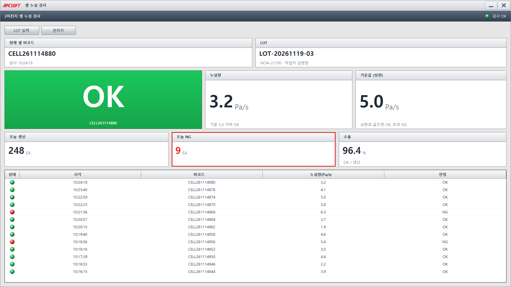
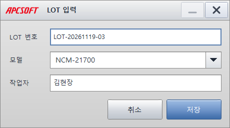

# 2회차 시연 B — 2차전지 셀 누설 검사기 (CellLeakTester)

> 시연은 Sonnet 서브에이전트가 했다. 하위 에이전트는 보고서 파일을 쓸 수 없어서, 에이전트가 돌려준 보고 본문을 메인 세션이 저장했다.

## 프롬프트

```
2차전지 셀 누설 검사기 현장 프로그램 만들어줘. 프로젝트명 CellLeakTester, 고객사 default.
메인 화면: 현재 셀 바코드·LOT, 누설량(Pa/s) 현재값과 판정(OK/NG) 크게, 기준값(상한 5.0 Pa/s), 오늘 생산 수량·NG 수량·수율, 최근 검사 이력 표(시각, 바코드, 누설량, 판정).
dialog: LOT 입력(LOT 번호, 모델, 작업자), 관리자 비밀번호.
```

## 1. 진행 과정 요약

- `new-project.sh`가 `완료 (new, v4.0)`로 끝났다.
- 템플릿
  - 메인은 `JudgeView`를 골격으로 썼다. 스캔·모델 콤보 줄은 빼고 `LOT 입력`·`관리자` 버튼 줄을 넣었다.
  - LOT 입력은 `RecipeDialog` 방식(이름표+입력칸 → 검증 → Confirm → OK)으로, 관리자 비밀번호는 `AdminPasswordDialog`를 옮겨 만들었다.
- 판정 함수는 `LeakJudge.IsOk` 하나다. 상한 5.0과 같으면 OK, 초과하면 NG이고, 카드·판정판·이력 표가 이 함수를 함께 쓴다.
- render는 3회 돌렸다.
  - MainForm 1회차에 `점검 1건`이 나왔다: 표 세로 스크롤바(행 24 중 13행 보임). 이력을 13행으로 줄여 다음 render에서 `점검 0건`이 됐다.
  - dialog 2개는 처음부터 `점검 0건`이었다.
- 눈 확인으로 고친 항목은 없다.

## 2. 결과 화면



위에서부터 LOT 입력·관리자 버튼, 현재 셀 바코드·LOT 카드, 큰 OK 판정판과 누설량 3.2 / 기준 5.0 카드, 오늘 생산 248·NG 9·수율 96.4, 이력 13행(5.0 OK 경계 행, NG 2건)이다.



LOT 번호, 모델(콤보), 작업자 입력칸과 [취소][저장] 버튼이 있다.


마스킹된 비밀번호 입력칸과 [취소][확인] 버튼이 있다.

## 3. 빌드/render 최종 결과

| 항목 | 결과 |
|---|---|
| 빌드 | 경고 0, 오류 0 |
| MainForm / LotDialog / AdminPasswordDialog | 점검 0건 / 0건 / 0건 |

## 4. 스킬 피드백 (에이전트 보고)

1. **heredoc 실패:** 경고를 읽고도 한글 heredoc 5개를 한 번에 보내 `unexpected EOF while looking for matching '''`로 실패했다. 파일 2개만 만들어졌다.
2. **템플릿 가이드 부족:** 스캔 입력 없이 "현재 셀"만 보여 주는 판정 화면에서 템플릿의 무엇을 빼고 남길지 가이드가 없다.
3. **단일 설비 헤더 문구:** 단일 설비 화면의 헤더 문구 기준이 없다. 이번에는 "검사 OK"로 정했다.
4. **관리자 비밀번호 검증:** 검증 주체와 샘플 비밀번호 규칙이 없다. 이번에는 `IMainViewSource.CheckAdminPassword`를 두고 "비어 있지 않으면 통과"로 샘플을 만들었다.
5. **판정판 SubText:** OK일 때 SubText에 무엇을 쓸지 규칙이 없다. 이번에는 바코드를 넣었다.
6. **NG 수 카드 색:** NG 수 카드를 NG > 0이면 Alarm으로 칠했다. `JudgeView` 템플릿은 그렇게 하지만, 4-1 "판정 기준 없는 값(수량)은 Run"과 충돌한다.
7. **추측한 것:** 수율 계산식 `(생산-NG)/생산`, Warn 없음(경고 시작값이 없어서), 샘플 바코드·LOT 형식, `Pa/s`를 `Pa`와 같은 `0.0`으로 본 것.

## 메인 세션 확인

- PNG 소견: 이력 표 아래에 한 줄 정도 빈틈이 있지만 점검 기준 이내다. 기준값 카드 footer "상한과 같으면 OK, 초과 NG"는 규칙 설명이 화면 문구로 새어 나온 것이다.
