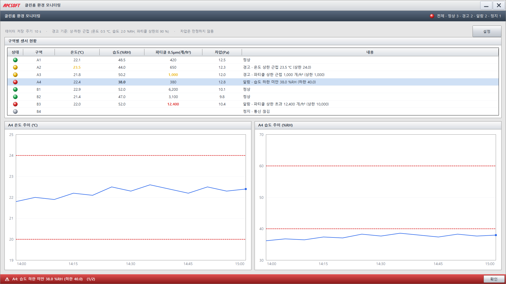
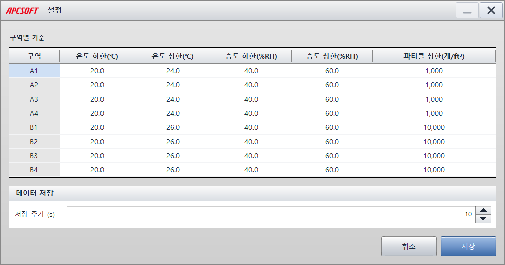

# 2회차 시연 C — 클린룸 환경 모니터링 (CleanroomMonitor)

> 시연은 Sonnet 서브에이전트가 했다. 에이전트가 돌려준 보고 본문을 메인 세션이 저장했다.

## 프롬프트

```
클린룸 환경 모니터링 프로그램 만들어줘. 프로젝트명 CleanroomMonitor, 고객사 default.
메인 화면: 구역 8곳(A1~A4, B1~B4)의 온도·습도·파티클(0.5µm, 개/ft³)·차압(Pa) 센서 목록 표, 기준 이탈 구역 강조, 선택 구역 온습도 추이 그래프, 헤더에 전체 정상/경고/알람 구역 수 요약.
dialog: 설정(구역별 온도·습도 상하한, 파티클 상한, 데이터 저장 주기).
```

## 1. 진행 과정 요약

- 템플릿: `TempHumiView`와 `EquipmentView`를 읽었지만 맞는 구조가 없었다. `ApcTemplateView` 위에 새로 배치했다.
  - 상단 안내 줄과 [설정] 버튼
  - `ApcGroup` 안의 `ApcGrid` 8행(`HeightFor(ApcGrid.HeightForRows(8))`)
  - 추이 그래프 2개(온도·습도)
- dialog: `LotInputDialog`(입력 표)와 `SettingsDialog`(`AddGroup`)를 참고했다.
- 판정 함수는 `ZoneJudge.Evaluate` 하나다. 표·헤더 요약·알람바가 함께 쓴다.
  - 경계 샘플: A2 23.5 ℃(경고 시작값), A3 파티클 1,000(상한과 같아 경고, 알람 아님)
  - 알람 2건(A4 습도 하한 미만, B3 파티클 상한 초과), 정지 1건(B4 통신 끊김)
- 표 행을 누르면 추이 그래프가 그 구역으로 바뀐다. 기본 선택 행은 A4다.
- render는 2회 돌렸다. 1회차부터 `점검 0건`이었다.
  - 눈 확인으로 고친 것: 램프 열 제목 "상태"와 글 열 제목 "상태"가 겹쳐 글 열을 "내용"으로 바꿨다.

## 2. 결과 화면



- 헤더: "전체 · 정상 3 · 경고 2 · 알람 2 · 정지 1"
- 상단 안내 줄에 경고 기준과 "차압은 판정하지 않음"을 적었다.
- 이탈 값 셀은 굵은 글자에 상태색을 칠했다.
- A4 선택 상태의 온도·습도 추이에 상·하한 점선이 있다.



- 구역별 기준을 넣는 입력 표 8행이 있다.
- "데이터 저장" 묶음에 저장 주기(s)가 있다.
- 아래쪽에 [취소][저장] 버튼이 있다.

## 3. 빌드/render 최종 결과

| 항목 | 결과 |
|---|---|
| 빌드 | 경고 0, 오류 0 |
| MainForm / ZoneSettingsDialog | 점검 0건 / 0건 |

## 4. 스킬 피드백 (에이전트 보고)

1. **경고 근접 폭 기준 없음:** 온도 0.5 ℃, 습도 2.0 %RH, 파티클 상한의 90 %로 짐작했다. 정한 값은 화면 안내에 적었다.
2. **경계값 샘플:** 경고 구간이 상한을 덮으면 "상한과 같은 값 = OK" 행을 보여 줄 수 없다.
3. **기준 없는 측정값:** 차압은 기준이 없어 판정하지 않았다. 이런 값을 어떻게 다룰지 규칙이 없다.
4. **샘플 기준값과 단위:** 구역별 샘플 기준값은 짐작했다. 파티클 수 단위는 `#,0`으로 했다.
5. **헤더 램프 색:** 정하는 규칙이 없어 가장 나쁜 상태(알람 > 경고 > 정지 > 정상) 순으로 정했다.
6. **이탈 구역 강조 방식:** 4-1에 없어서 셀 글자색·굵게 + 램프 + 내용 문구로 했다.
7. **선택 표시:** 표 행을 선택 표시로 쓰는 법(`ClearInitialSelection = false`)이 SKILL.md에는 입력 표 용도로만 나온다.
8. **열 제목 중복:** `ApcLampColumn` 기본 제목 "상태"와 겹치는 것을 render가 잡지 못한다.
9. **알람바 갱신:** 지우는 API가 없어 설정 변경 뒤 알람바를 다시 갱신하지 않았다.
