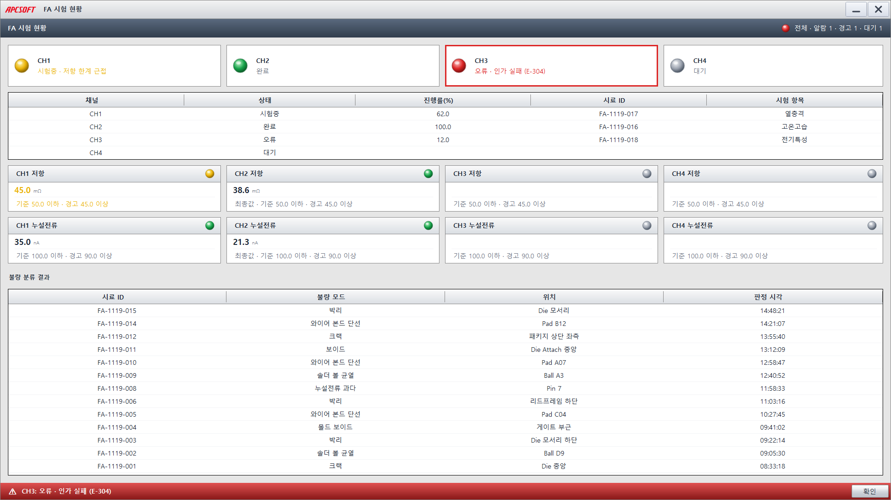
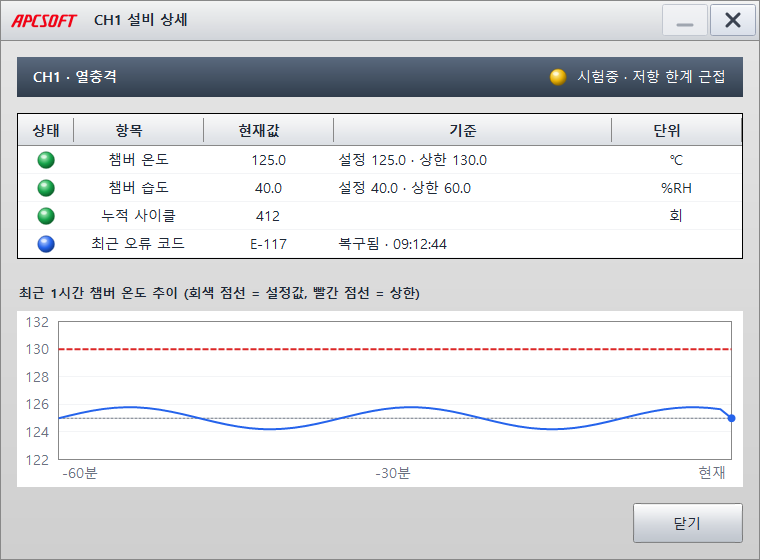

# 2회차 시연 D — 반도체 패키지 FA 시험기 (FATester)

> Sonnet 서브에이전트가 시연을 수행하고 보고 본문을 반환했다. 이 파일은 메인 세션이 그 본문을 저장한 것이다.

## 프롬프트

```
반도체 패키지 Failure Analysis 시험기 현장 프로그램 만들어줘. 프로젝트명 FATester, 고객사 default.
메인 화면: 시험 채널 4개(CH1~CH4)별 진행 상태(시험중/완료/오류/대기)와 진행률, 현재 시료 ID·시험 항목(열충격/고온고습/전기특성), 채널별 측정값(저항 mΩ, 누설전류 nA) 현재값, 불량 분류 결과 표(시료 ID, 불량 모드, 위치, 판정 시각).
dialog: 설비 상세(채널 선택 시 챔버 온도·습도·누적 사이클·최근 오류 코드).
```

## 1. 진행 과정 요약

- 참고 템플릿
  - `EquipmentView`: 타일 줄 + 카드 줄 + 표
  - `EquipmentDetailDialog`: 상태 줄 + 표 + 추이 + 닫기
- 메인 화면 배치(위에서 아래로)
  - 채널 타일 4개
  - 채널 현황 표(채널·상태·진행률·시료 ID·시험 항목)
  - 저항 카드 4개
  - 누설전류 카드 4개
  - 불량 분류 표
  - 타일을 누르면 설비 상세 dialog가 열린다. 카드가 4채널을 다 보여 주므로 `Selected`는 쓰지 않았다.
- 판정
  - 판정 함수는 `Judge` 하나다.
  - CH1 저항 45.0 mΩ은 경고 시작값과 같은 값이라 경고다.
  - CH3(오류)와 CH4(대기)는 값이 빈칸이고 카드 상태는 `Stop`이다.
- render 과정
  - 1회차 `점검 2건`: 채널 표에 Dock이 없어 겹쳤다. Top Panel로 감싸고 Padding으로 아래 간격을 줬다.
  - 2회차 `점검 0건`: "참고: 표 아래가 빔"이 나와 불량 표 행을 11개에서 13개로 늘렸다.

## 2. 결과 화면



- 채널 타일 4개가 있다. 상태는 CH1 "시험중 · 저항 한계 근접", CH3 "오류 · 인가 실패 (E-304)"다.
- 그 아래에 채널 현황 표, 카드 8개, 불량 분류 표 13행이 있고, 맨 아래에 알람바가 있다.
- 헤더 요약은 "전체 · 알람 1 · 경고 1 · 대기 1"이다.



- CH1 상세 화면이다.
- 상태 줄, 챔버 온도·습도·누적 사이클·최근 오류 코드 표, 온도 추이, [닫기]가 있다.

## 3. 빌드/render 최종 결과

| 항목 | 결과 |
|---|---|
| 빌드 | 경고 0, 오류 0 |
| MainForm / ChannelDetailDialog | 점검 0건 / 0건 |

## 4. 스킬 피드백 (에이전트 보고)

1. **소수 자리:** mΩ·nA·진행률 %의 소수 자리를 짐작해 모두 `0.0`으로 했다. 사용자에게 물어야 하지만 시연 조건상 질문할 수 없었다.
2. **기준값:** 저항 50/45, 누설전류 100/90, 챔버 경고 폭을 모두 짐작했다. 요구서에 없을 때 정하는 규칙이 없다.
3. **Dock:** 고정 높이 `ApcGrid`에 `Dock = Top`이 필요하다는 안내가 없다. 4a에는 SectionTitle/Caption만 나온다.
4. **표 아래 간격:** Top으로 쌓은 표의 아래 간격은 `Columns()`와 달리 자동으로 생기지 않는다. render도 이를 점검하지 않았다.
5. **오류 채널의 값:** 오류 채널이 값을 읽었는지 기준이 없어 값을 비웠다.
6. **경고 문구:** 경고 기준 문구 예시가 없어 "기준 50.0 이하 · 경고 45.0 이상"으로 짐작했다.
7. **램프 열:** 채널 현황 표에서 램프 열을 뺐다. 상태가 타일과 겹치기 때문인데, 이것이 규칙 위반인지 불명확하다.

## 메인 세션 확인

1회차 지적 사항이 해결된 것을 확인했다.
- 진행률 카드 3중 강조: 진행률을 표로 옮기면서 해결됐다.
- 불량표의 색만 있는 램프: 램프 열을 없애 해결됐다.
- 값이 없을 때 판정하던 문제: 값이 없으면 판정하지 않는다.
