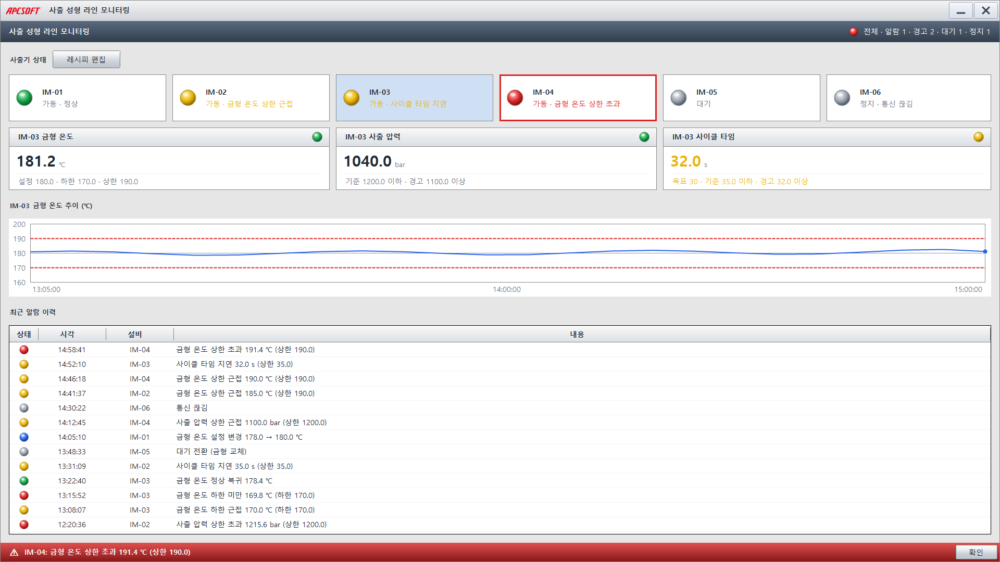
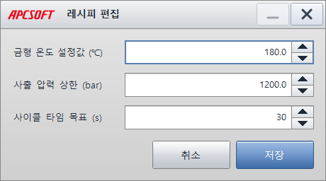

# 3회차 시연 A — 사출 성형 라인 모니터링 (InjectionMonitor)

> Sonnet 서브에이전트가 시연하고 보고 본문을 반환했고, 메인 세션이 저장했다. 프롬프트는 1회차와 같다.

## 1. 진행 과정 요약

- 템플릿: `EquipmentView`, `RecipeDialog`
- 판정 함수와 상수는 `Data/Judgement.cs` 한 곳에 있다. 타일·카드·이력·그래프 기준선이 모두 이것을 쓴다.
- render 4회
  1. 1회차 `점검 1건`: 표 세로 스크롤바. 그래프를 줄이고 샘플 행을 줄였다.
  2. 2회차: 참고 줄 "표 아래가 빔"이 나와 행을 1개 늘렸다.
  3. 3회차: `점검 0건`, 참고 줄 없음.
  4. `RecipeDialog`는 처음부터 `점검 0건`이었다.
- 눈 확인으로 고친 것은 없다.

## 2. 결과 화면

- 위쪽: 타일 6개. IM-03은 선택 상태, IM-04는 알람 테두리다.
- 가운데: IM-03 카드 3개와 금형 온도 추이(설정선, 상·하한선).
- 아래쪽: 알람 이력 13행, 알람바.

레시피 편집 dialog다. 입력 3칸과 [취소][저장]이 있다.

## 3. 빌드/render 최종 결과

| 항목 | 결과 |
|---|---|
| 빌드 | 경고 0개, 오류 0개 |
| MainForm / RecipeDialog | 점검 0건 / 0건 |

## 4. 정한 기준값 (요구서에 없어 에이전트가 정함)

- 금형 온도: 설정 180.0 ℃, 하한 170.0, 상한 190.0, 경고 175.0 이하 / 185.0 이상
- 사출 압력: 상한 1200.0 bar, 경고 1100.0 이상
- 사이클 타임: 목표 30 s, 상한 35.0, 경고 32.0 이상
- 한계: 레시피를 저장해도 판정 상수는 그대로다. 실제 연결 때 바꿔야 한다.

## 5. 스킬 피드백 (에이전트 보고)

1. 4-1 소수 자리 표에 MPa가 없다.
2. `Row()`가 Dock Top인지 SKILL.md에 적혀 있지 않다.
3. dialog를 여는 버튼을 어디에 둘지 기준이 없다.
4. 정상 복귀·설정 변경 이력 행의 상태색을 짐작했다(복귀 = Run, 설정 변경 = Info).
5. "정지 · 통신 끊김"이 "값 없음이면 이상 사유 문구 없음" 규칙과 충돌하는지 애매했다.
6. 경고 구간이 상한까지 덮을 때, 상한과 같은 값의 문구를 "상한 근접 190.0 (상한 190.0)"으로 짐작했다.

## 메인 세션 확인

PNG에서 다음을 확인했다.
- 선택 타일, 경계값 판정·문구, 이력의 시각 순서가 모두 규칙대로다.
- 에이전트가 정한 기준값 목록을 보고했다(2회차에 추가한 규칙이 지켜졌다).
