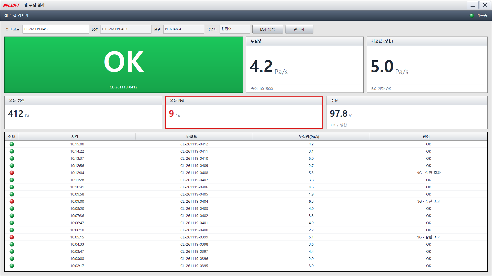
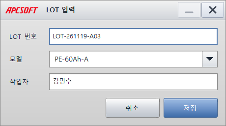
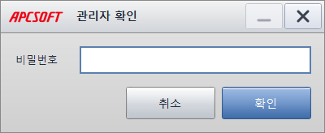

# 3회차 시연 B — 2차전지 셀 누설 검사기 (CellLeakTester)

> Sonnet 서브에이전트가 시연을 수행하고 보고 본문을 반환했다. 메인 세션이 그 본문을 저장했다. 프롬프트는 1회차와 같다.

## 1. 진행 과정 요약

- 출발 템플릿
  - 메인 화면: `JudgeView`
  - LOT 입력 dialog: `RecipeDialog` 방식
  - 관리자 비밀번호 dialog: `AdminPasswordDialog`
- render 진행
  - 1회차: `점검 1건`(표 세로 스크롤바). 이력 샘플을 22행에서 18행으로 줄였다.
  - 행을 줄이는 중 간격 배열 길이가 맞지 않아 render가 `생성 실패: 인덱스가 배열 범위를 벗어났습니다`로 멈췄다. 에이전트의 실수였다.
  - 2회차: `점검 0건`.
- 눈 확인으로 고친 곳은 없다.

## 2. 결과 화면

- 위쪽: 바코드·LOT·모델·작업자를 보여 주는 읽기 전용 칸 한 줄
- 가운데: OK 판정판, 누설량 4.2 Pa/s, 기준 5.0 Pa/s
- 오늘 집계: 생산 412, NG 9, 수율 97.8 %
- 아래쪽: 이력 18행(5.0은 OK, 5.1·5.3·6.8은 NG)
- 헤더: "가동중"(설비 한 대 화면 규칙)

## 3. 빌드/render 최종 결과

| 항목 | 결과 |
|---|---|
| 빌드 | 경고 0, 오류 0 |
| MainForm | 점검 0건 |
| LotDialog | 점검 0건 |
| AdminPasswordDialog | 점검 0건 |

## 4. 정한 기준값

- 상한 5.0 Pa/s(요구서). 5.0은 OK, 초과부터 NG. 경고 구간은 없다.
- 상수는 `LeakRules`에 있다.
- 모델 후보와 비밀번호 샘플 "1234"는 샘플 데이터다.

## 5. 스킬 피드백 (에이전트 보고)

1. render의 생성 실패 메시지에 원인 코드 위치가 없어서 코드를 직접 뒤져 찾았다.
2. 수율 카드의 Status 기준을 짐작했다(Run으로 둠).
3. 읽기 전용 값을 무슨 컨트롤로 보여 줄지 4c 표에 없다.
4. `Row()` 안의 Caption과 입력칸이 세로로 미세하게 어긋나 보인다.
5. 관리자 비밀번호 다음에 열 화면이 정해지지 않았다(데이터 연결 범위).
