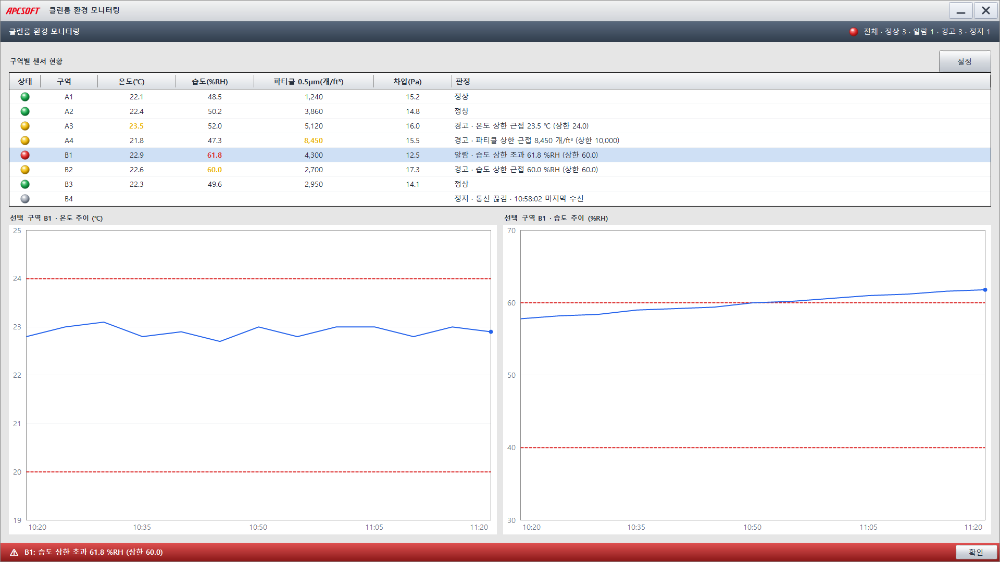
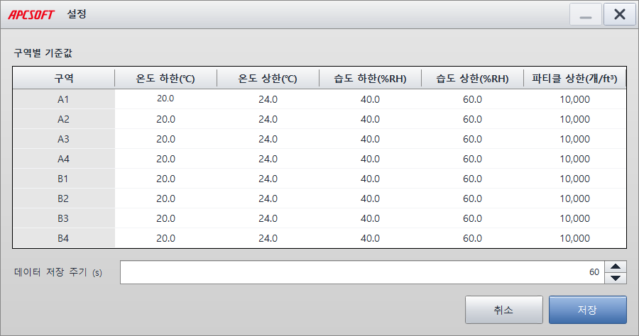

# 3회차 시연 C — 클린룸 환경 모니터링 (CleanroomMonitor)

> Sonnet 서브에이전트가 시연을 수행했고, 메인 세션이 에이전트의 보고 본문을 저장했다. 프롬프트는 1회차와 같다.

## 1. 진행 과정 요약

- **화면 구성:** 맞는 템플릿이 없어 `ApcTemplateView` 위에 새로 배치했다.
  - 위쪽: 제목과 [설정] 버튼
  - 가운데: 표 8행(`Columns(HeightForRows(8), …)`로 감쌈)
  - 아래쪽: 추이 그래프 2개(Fill)
- **판정:** 판정 함수 하나(`ZoneJudge.Judge`)를 표의 램프·문구·강조, 헤더, 알람바가 함께 쓴다.
- **render 3회**
  1. MainForm `점검 1건`: "열 제목 '상태' 중복". 2회차에 추가한 점검이 잡았다. 글 열 제목을 '판정'으로 바꿨다.
  2. MainForm `점검 0건`.
  3. 눈으로 보고 2건을 고친 뒤 `점검 0건`.
     - [설정] 버튼이 제목 줄 아래로 삐져나와 있었다.
     - 선택 행에서 알람 값의 색이 선택 글자색에 묻혔다. `SelectionForeColor`를 직접 지정했다.

## 2. 결과 화면

- 헤더: "전체 · 정상 3 · 알람 1 · 경고 3 · 정지 1"
- 표 8행: 이탈 값은 색과 굵게로 표시, 판정 문구 열 있음
- 선택 구역 B1의 온도·습도 추이

구역별 기준 입력 표 8행, 저장 주기 입력, [취소][저장] 버튼으로 구성된다.

## 3. 빌드/render 최종 결과

| 항목 | 결과 |
|---|---|
| 빌드 | 경고 0, 오류 0 |
| MainForm / SettingsDialog | 점검 0건 / 0건 |

## 4. 정한 기준값

- 온도: 20.0~24.0 ℃, 경고 폭 0.5
- 습도: 40.0~60.0 %RH, 경고 폭 2.0
- 파티클: 상한 10,000, 상한의 80 %부터 경고
- 차압: 10.0~25.0 Pa, 경고 폭 2.0
- 저장 주기: 60 s

## 5. 스킬 피드백 (에이전트 보고)

1. 램프 열 제목이 "상태"라는 점이 SKILL.md에 없다. render가 알려 줘서 알았다.
2. 헤더 요약 항목의 순서가 명시돼 있지 않다.
3. 경고 구간이 상한을 덮을 때 "상한과 같은 값은 정상"과 "경고 시작 이상은 경고"가 충돌해 보인다. 경고가 우선이라고 해석했다.
4. 표 셀 강조 방법과 `SelectionForeColor` 문제에 대한 안내가 없다.
5. Fill 그래프 2개를 나란히 놓는 방법이 없어 `TableLayoutPanel` 퍼센트 2열로 짰다. render 점검은 0건이었다.
6. 짧은 수정에는 sed와 python heredoc을 썼는데, 한글 문제는 없었다.
