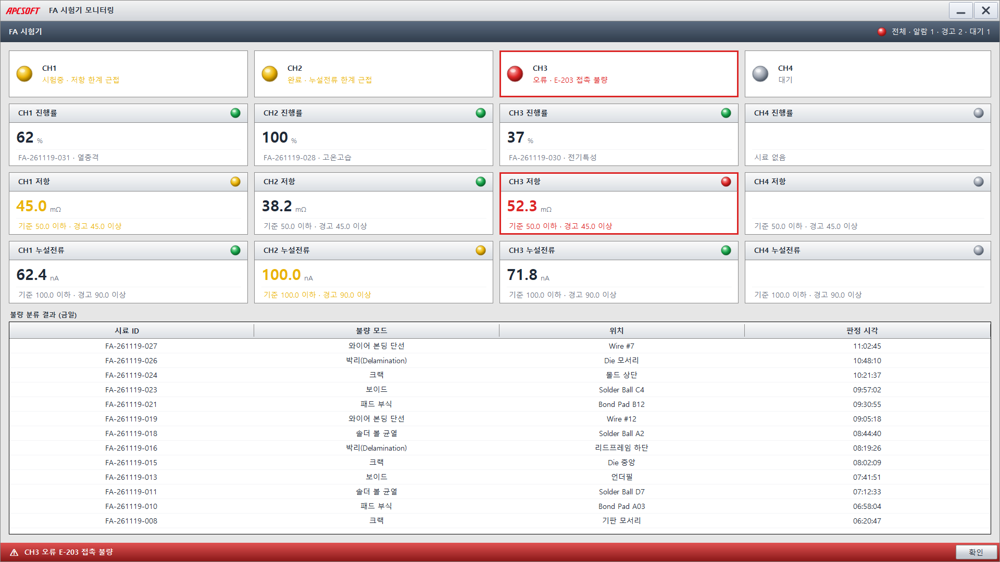
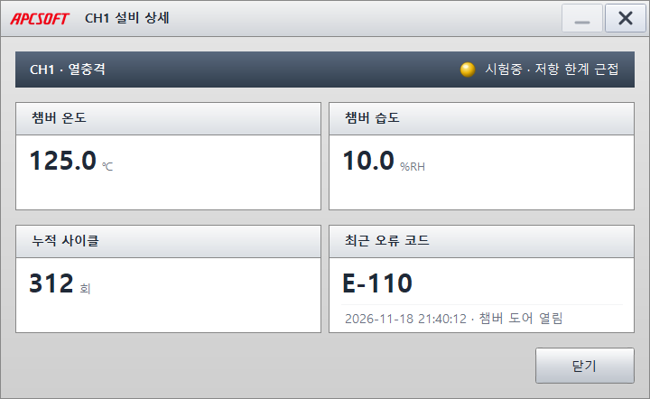

# 3회차 시연 D — 반도체 패키지 FA 시험기 (FATester)

> Sonnet 서브에이전트가 시연을 수행하고 보고 본문을 반환했다. 이 파일은 메인 세션이 그 본문을 저장한 것이다. 프롬프트는 1회차와 같다.

## 1. 진행 과정 요약

- **화면 구성:** `EquipmentView`를 기준으로 짰다. 순서는 타일 → 카드 3줄(진행률·저항·누설전류) → 불량 표다.
- **dialog:** `EquipmentDetailDialog` 골격(상태 줄 + 닫기)에 `AddContentRow` 카드 2×2를 넣었다.
- **render(3회)**
  - 1회차: `점검 0건`. "참고: 표 아래가 빔"이 나와 불량 표를 13행으로 늘렸다.
  - 2회차: `점검 0건`. 참고 줄도 없었다.
- **눈 확인:** 고친 것은 없다.

## 2. 결과 화면

- 타일 상태 문구는 다음과 같다.
  - CH1: "시험중 · 저항 한계 근접"
  - CH2: "완료 · 누설전류 한계 근접"
  - CH3: "오류 · E-203 접촉 불량"
  - CH4: "대기"
- 카드 12개와 불량 표 13행이 있다.

CH1 상세 화면이다. 상태 줄, 카드 2×2(`AddContentRow`), [닫기]로 이루어져 있다.

## 3. 빌드/render 최종 결과

| 항목 | 결과 |
|---|---|
| 빌드 | 경고 0, 오류 0 |
| MainForm / ChannelDetailDialog | 점검 0건 / 0건 |

## 4. 정한 기준값

| 항목 | 값 |
|---|---|
| 저항 | 상한 50.0 mΩ, 경고 45.0 이상 |
| 누설전류 | 상한 100.0 nA, 경고 90.0 이상 |
| 소수 자리 | mΩ·nA `0.0`, 진행률 정수 |

mΩ·nA 소수 자리는 고객 확인이 필요하다고 보고했다.

## 5. 스킬 피드백 (에이전트 보고)

1. 채널 × 항목 격자 배치에 대한 예시가 없다.
2. 대기 채널의 빈칸과 정지 설비가 읽은 값의 경계가 애매하다.
3. "완료 · 한계 근접" 문구가 자연스러운지 모르겠다.
4. 오류 채널(CH3)의 진행률 카드가 초록이라, 빨강인 타일과 어긋나 보인다.
5. dialog 카드 Footer를 비워 두었다.
6. 메인 헤더 제목("FA 시험기")과 창 제목("FA 시험기 모니터링")이 다르다. 둘의 관계를 정한 규칙이 없다.

## 메인 세션 확인

- 4번은 PNG로 확인했다. 오류 채널의 진행률 카드가 초록 램프로 보인다.
- 6번도 PNG로 확인했다. 창 제목과 헤더 제목이 다르다.
- `AddContentRow`가 처음 실사용됐고, `점검 0건`으로 잘 동작했다.
