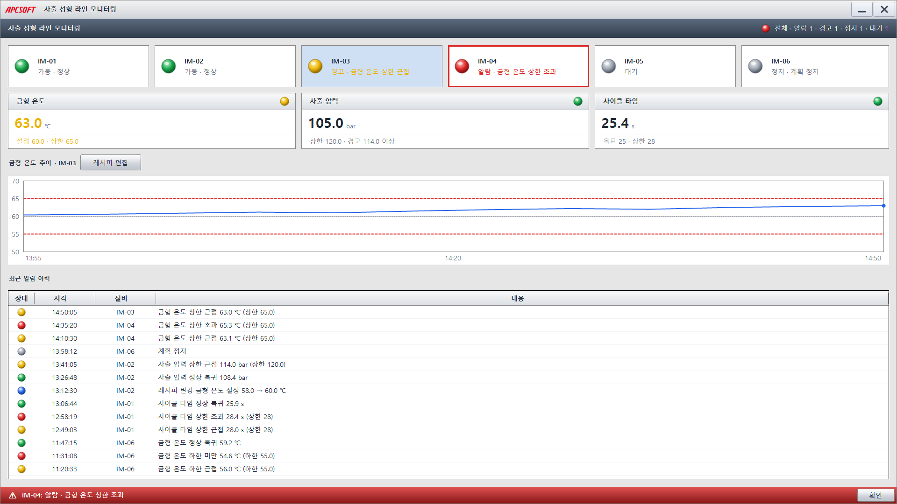
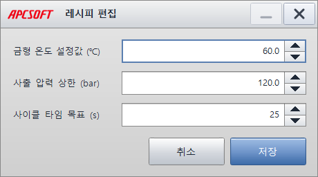

# 4회차 시연 A — 사출 성형 라인 모니터링 (InjectionMonitor)

> 시연은 Sonnet 서브에이전트가 했고, 반환한 보고 본문을 메인 세션이 저장했다. 프롬프트는 1회차와 같다. 사용량 한도로 중간에 멈췄다가 같은 에이전트가 이어서 끝냈다.

## 1. 진행 과정 요약

- 템플릿: `EquipmentView`, `RecipeDialog`. 추이 구획 제목 줄에 [레시피 편집] 버튼을 두었다.
- render 1회차: `점검 1건`(표 세로 스크롤바, 행 14 중 13행 보임). 이력을 13행으로 줄였다.
- render 2회차: `점검 0건`.
- 눈 확인으로 고친 것: 없음.

## 2. 결과 화면

- 타일 6개: IM-03은 선택·경고, IM-04는 알람.
- IM-03 카드 3개, 금형 온도 추이(설정선·상한선·하한선), 이력 13행, 알람바.

## 3. 빌드/render 최종 결과

| 항목 | 결과 |
|---|---|
| 빌드 | 경고 0, 오류 0 |
| MainForm / RecipeDialog | 점검 0건 / 0건 |

## 4. 정한 기준값

| 항목 | 설정·목표 | 상한 | 하한 | 경고 시작 |
|---|---|---|---|---|
| 금형 온도 | 설정 60.0 ℃ | 65.0 | 55.0 | 63.0 이상 / 56.0 이하 |
| 사출 압력 | — | 120.0 bar | — | 114.0 이상 |
| 사이클 타임 | 목표 25 s | 28 | — | 27 이상 |

## 5. 스킬 피드백 (에이전트 보고)

1. **사이클 타임 기준값의 소수 자리:** 상한·경고값을 "시간 설정"(정수)과 측정값(`0.0`) 중 어느 쪽으로 볼지 규칙이 없다. 그래서 "25.4 s"와 "상한 28"처럼 자리수가 섞였다.
2. **정지 설비가 읽은 값:** 읽은 값이 이상일 때 타일을 알람으로 해야 하는지 모호했다. 정상 값만 넣어 피했다.
3. **헤더 집계:** 정지와 대기를 따로 세는 규칙은 "화면 문구가 다르면"이라는 조건으로 해석했다.
4. **dialog 버튼 위치:** dialog를 여는 버튼을 어디에 둘지 기준이 없다.
5. **값 없는 그래프:** 값이 없는 설비의 그래프를 어떻게 그릴지 규칙이 없다.
6. **"참고"와 "점검"의 차이:** 표 세로 스크롤바는 "참고"가 아니라 "점검"으로 나왔다. SKILL.md 샘플 행 수 설명과 조금 다르다.

## 메인 세션 확인

- 피드백 1번은 PNG에서도 보인다. 이력에 "28.4 s (상한 28)"이 있는데, 4-1 "기준 문구도 같은 자리수" 규칙에 어긋난다.
