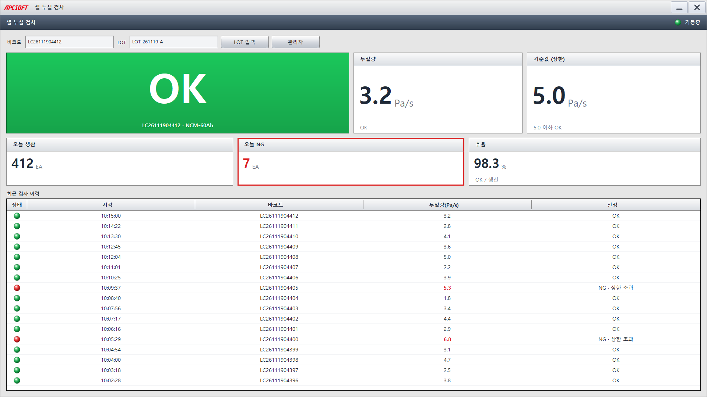
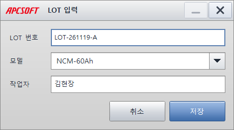

# 4회차 시연 B — 2차전지 셀 누설 검사기 (CellLeakTester)

> Sonnet 서브에이전트가 시연을 수행하고 보고 본문을 반환했다. 메인 세션이 그 본문을 저장했다. 프롬프트는 1회차와 같다.

## 1. 진행 과정 요약

- 템플릿
  - 메인 화면은 `JudgeView`에서 출발했다. 스캔 줄은 읽기 전용 바코드·LOT 칸과 버튼으로 바꿨다.
  - LOT 입력 dialog는 `RecipeDialog` 방식을 썼다.
  - 관리자 비밀번호 dialog는 `AdminPasswordDialog`를 썼다.
- 첫 빌드에서 오류가 났다: `CS1503: 'bool'에서 'FontStyle'(으)로 변환할 수 없습니다`. `ApcTheme.GetFont(FontStyle.Bold)`로 바꿔 해결했다.
- render
  - 1회차에 `점검 1건`(표 세로 스크롤바)이 나왔다. 이력을 17행으로 줄였다.
  - 2회차에는 세 화면 모두 `점검 0건`이었다.
- 눈 확인에서 고친 것은 없다.

## 2. 결과 화면

- 읽기 전용 바코드·LOT 칸과 버튼, OK 판정판, 누설량 3.2 / 기준 5.0, 오늘 집계(412 / 7 / 98.3 %)가 보인다.
- 이력은 17행이다. NG 값 셀은 빨간 굵은 글씨이고, 5.0 행은 OK다.
- 헤더 표시는 "가동중"이다.

## 3. 빌드/render 최종 결과

| 항목 | 결과 |
|---|---|
| 빌드 | 경고 0, 오류 0 |
| MainForm / LotInputDialog / AdminPasswordDialog | 점검 0건 / 0건 / 0건 |

## 4. 정한 기준값

- 상한 5.0 Pa/s(요구서). 경고 구간은 없다.
- `Pa/s`는 소수 자리 표에 없어서 `Pa`에 맞춰 `0.0`으로 했다.
- 수율은 OK / 생산이다.

## 5. 스킬 피드백 (에이전트 보고)

1. `Pa/s`가 소수 자리 표에 없다. 질문이 금지된 상황에서 쓸 기본값 규칙이 없다.
2. 굵은 글씨를 만드는 호출법 `GetFont(FontStyle.Bold)`가 SKILL.md에 없다. 처음에 bool을 넘겨 빌드 오류가 났다.
3. 화면의 `SectionTitle`과 dialog의 `SectionTitle`이 이름이 같아 헷갈린다.
4. 판정 화면에서 NG가 나면 알람바에 올릴지 정한 규칙이 없다. `JudgeView` 관례대로 올리지 않았다.
5. 도구 오작동은 없었다.

## 메인 세션 확인

PNG를 확인한 결과 규칙에 어긋나는 곳은 없다. 3회차에 고친 "이탈 값 셀 강조"가 그대로 쓰였다.
