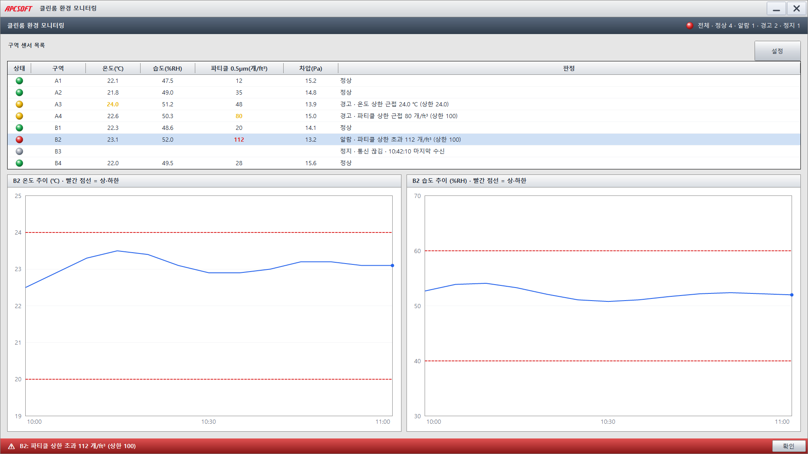
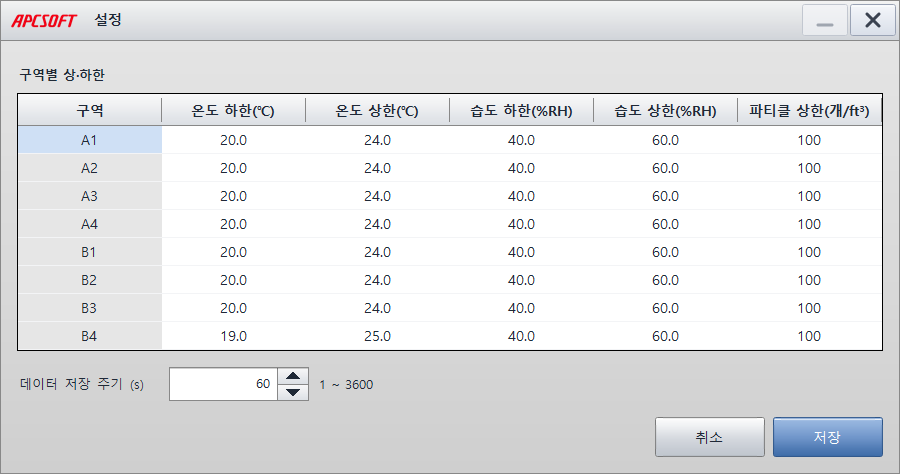

# 4회차 시연 C — 클린룸 환경 모니터링 (CleanroomMonitor)

> Sonnet 서브에이전트가 시연을 수행하고 보고 본문을 반환했고, 메인 세션이 저장했다. 프롬프트는 1회차와 같다.
> 사용량 한도로 중간에 멈췄다가 같은 에이전트가 이어서 끝냈다.

## 1. 진행 과정 요약

- 메인 화면은 `ApcTemplateView` 위에 새로 배치했다.
  - 위: 제목과 [설정] 버튼
  - 가운데: 표 8행. `Columns(HeightForRows(8))`로 감쌌다.
  - 아래: `ApcGroup` 안에 온도·습도 추이 그래프 2개
  - 시작 선택 행은 B2(알람)다.
- dialog는 `LotInputDialog`처럼 입력 표 방식으로 만들었다. 저장 주기는 `AddFieldRow` + `ApcNumericBox`로 넣었다.
- render는 두 화면 모두 처음부터 `점검 0건`이었다.
- 눈으로 보고 고친 것은 두 가지다.
  - 추이 그래프의 회색 기준선(중간값)을 뺐다. 설정값으로 오해할 수 있어서다.
  - 제목 라벨을 버튼과 세로 가운데로 맞췄다.

## 2. 결과 화면

- 헤더: "전체 · 정상 4 · 알람 1 · 경고 2 · 정지 1"
- A3 온도 24.0은 상한과 같은 값이다. 경고 구간이 있으므로 경고로 판정했다.
- B3은 통신 끊김이라 값이 빈칸이다.

- 구역별 상·하한 입력 표가 있다.
- 저장 주기 60 s 입력칸 옆에 범위(1 ~ 3600)를 표시했다.

## 3. 빌드/render 최종 결과

| 항목 | 결과 |
|---|---|
| 빌드 | 경고 0, 오류 0 |
| MainForm / SettingsDialog | 점검 0건 / 0건 |

## 4. 정한 기준값

| 항목 | 기준 |
|---|---|
| 온도 | 20.0~24.0 ℃ (B4만 19.0~25.0 ℃), 경고 폭 0.5 |
| 습도 | 40.0~60.0 %RH, 경고 폭 2.0 |
| 파티클 | 상한 100, 상한의 80 %부터 경고 |
| 차압 | 10.0 Pa 미만 알람, 12.0 Pa 이하 경고 (고정값) |
| 저장 주기 | 60 s |

## 5. 스킬 피드백 (에이전트 보고)

1. 요구서에 없는 차압 기준을 설정 dialog에 넣지 않고 고정값으로 두었다. 짐작한 판단이다.
2. 파티클 단위(개/ft³)는 수량 규칙을 빌려 `#,0`으로 했다.
3. 통신이 끊긴 구역의 추이 그래프를 어떻게 그릴지 규칙이 없다.
4. 입력 표의 첫 열이 읽기 전용이면 그 칸이 선택된 채 시작한다. 1회차부터 같은 모습이었다.
5. 열 제목이 긴 열의 폭은 직접 정했다.
6. MSBuild `logfile`을 `../b.log`로 주면 `C:\b.log`로 풀려서, 정리(rm)가 안전 검사에 막혔다.

## 메인 세션 확인

PNG에서 4번을 확인했다. dialog 표에서 읽기 전용 구역 칸 A1이 파랗게 선택돼 있다.
