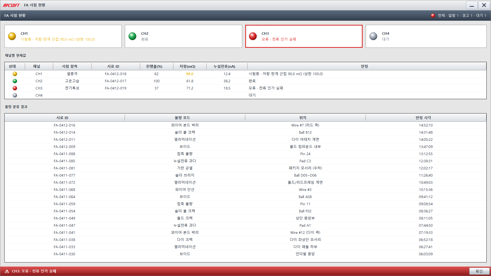
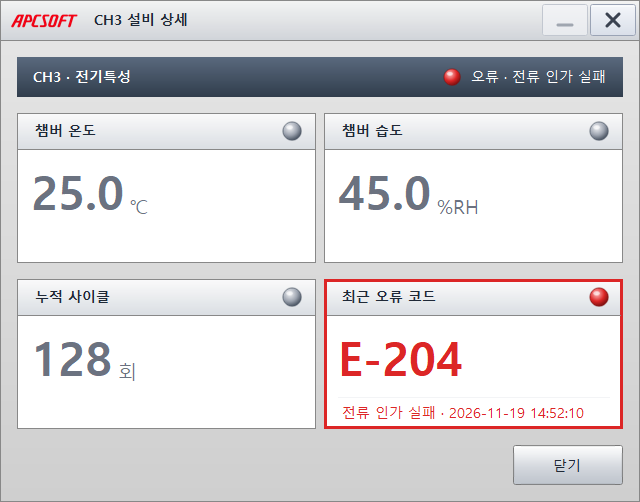

# 4회차 시연 D — 반도체 패키지 FA 시험기 (FATester)

> Sonnet 서브에이전트가 시연을 수행하고 보고 본문을 반환했다. 메인 세션이 그 본문을 저장했다. 프롬프트는 1회차와 같다.
> 사용량 한도로 중간에 멈췄고, 같은 에이전트가 이어서 끝냈다.

## 1. 진행 과정 요약

- 메인 화면은 `EquipmentView` 구조(타일 → 표 → 알람바, 타일을 누르면 상세)를 따랐다.
- dialog는 `EquipmentDetailDialog` 틀에 `AddContentRow` 카드 2×2를 넣었다.
- 창 제목과 헤더 제목은 "FA 시험 현황"으로 같다. 3회차 규칙이 반영된 것이다.
- render 진행
  - 1회차: `점검 0건`. "참고: 표 아래가 빔"이 나와 불량 표를 19행으로 늘렸다.
  - 2회차: `점검 0건`. 참고 줄도 없었다.

## 2. 결과 화면

- 타일 4개, "채널별 현재값" 표, 불량 분류 표 19행, 알람바로 이루어져 있다.
- 채널별 현재값 표의 열: 상태·채널·시험 항목·시료 ID·진행률·저항·누설전류·판정.
- CH1 저항 90.0은 경고 시작값과 같은 값이다. 경고로 판정됐고, 노란 굵은 글자로 보인다.

- CH3 상세 화면이다. 정지 상태라 카드가 `Stop`(회색)이고, 오류 코드 카드는 `Alarm`이다.

## 3. 빌드/render 최종 결과

| 항목 | 결과 |
|---|---|
| 빌드 | 경고 0, 오류 0 |
| MainForm | 점검 0건 |
| ChannelDetailDialog | 점검 0건 |

## 4. 정한 기준값

| 항목 | 기준 |
|---|---|
| 저항 | 상한 100.0 mΩ, 경고 90.0 이상 |
| 누설전류 | 상한 50.0 nA, 경고 45.0 이상 |
| mΩ·nA 소수 자리 | `0.0` (고객 확인 필요) |
| 챔버 온도·습도 | 기준 없음. 판정하지 않는다 |

## 5. 스킬 피드백 (에이전트 보고)

1. 질문할 수 없을 때 단위별 소수 자리 기본값이 없다.
2. 현재값을 카드로 보일지 표로 보일지 정하는 기준이 없다.
3. `Selected` 규칙과 "타일을 누르면 상세 dialog" 패턴이 함께 쓰일 때 무엇이 우선인지 불분명하다. 이번 화면은 dialog만 여는 경우라 `Selected`를 쓰지 않았다.
4. 오류일 때 사유 문구를 짐작해 썼다. 오류 코드는 문구에 넣지 않았다.
5. 도구 오작동은 없었다.

## 메인 세션 확인

- PNG를 보면 규칙에 어긋나는 곳이 없다.
- 이전 회차 지적(진행률 3중 강조, 색만 있는 램프, 제목 불일치)이 다시 나오지 않았다.
