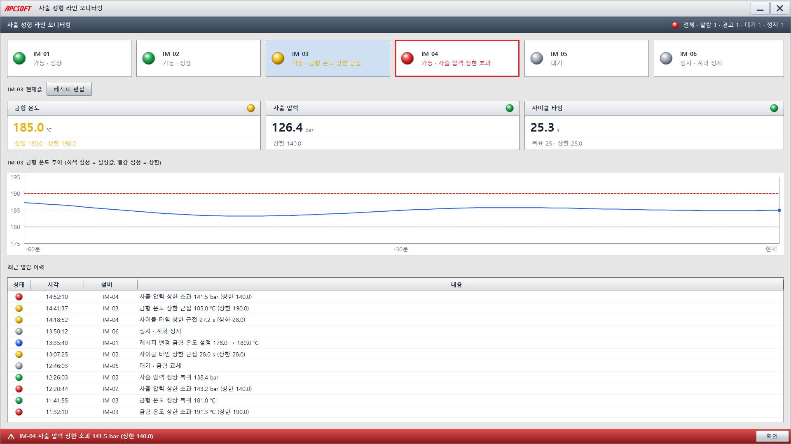
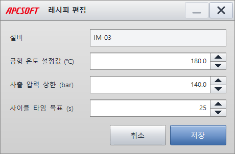

# 5회차 시연 A — 사출 성형 라인 모니터링 (InjectionMonitor)

> Sonnet 서브에이전트가 시연을 수행하고 보고 본문을 반환했다. 메인 세션이 그 본문을 저장했다. 프롬프트는 1회차와 같다.

## 1. 진행 과정 요약

- 템플릿: `EquipmentView`에 추이 그래프 줄을 추가했다. dialog는 `RecipeDialog`다.
- heredoc 실패: 처음에 heredoc 여러 개를 한 번에 보내 `unexpected EOF while looking for matching '`로 실패했다. 소스를 모두 Write 도구로 다시 썼다.
- render
  - 1회차: `점검 1건`(표 세로 스크롤바, 행 12 중 11행 보임). 이력을 11행으로 줄였다.
  - 2회차: `점검 0건`.
- 눈으로 보고 고친 것: 없음.

## 2. 결과 화면

- 위: 타일 6개. IM-03은 선택 + 경고, IM-04는 알람이다.
- 가운데: IM-03 카드 3개와 금형 온도 추이.
- 아래: 이력 11행과 알람바.
- 기준값은 "상한 28.0"처럼 측정값과 같은 자리수로 나온다(4회차 규칙 반영).

## 3. 빌드/render 최종 결과

| 항목 | 결과 |
|---|---|
| 빌드 | 경고 0, 오류 0 |
| MainForm | 점검 0건 |
| RecipeDialog | 점검 0건 |

## 4. 정한 기준값

| 항목 | 설정·목표 | 경고 시작 | 상한 |
|---|---|---|---|
| 금형 온도 | 설정 180.0 ℃ | 185.0 | 190.0 |
| 사출 압력 | — | 없음 | 140.0 bar |
| 사이클 타임 | 목표 25 s | 27.0 | 28.0 |

## 5. 스킬 피드백 (에이전트 보고)

1. heredoc 실패가 반복됐다. 에이전트는 경고 문구 자체는 정확했고 자기 실수라고 했다.
2. 정지 설비의 정상 값 카드를 Run(초록)으로 둘지 Stop으로 둘지 규칙이 없다. 이번에는 판정 결과를 따라 Run으로 했다.
3. 레시피에 저장한 값이 판정 기준에 반영되는지 안내가 없다. 이번 구현은 반영하지 않는다(데이터 연결 범위).
4. 저장 전 검증 규칙(설정값 < 경고 시작값)은 에이전트가 정했다.
5. 경고 구간이 없는 항목의 기준 문구로 "상한 140.0"과 "기준 140.0 이하" 중 무엇을 쓸지 정해져 있지 않다.
6. 알람 설비 타일의 공정 상태를 "가동"으로 쓸지 "알람"으로 쓸지 모호하다. 이번에는 "가동 · 사유"로 썼다.
7. `Row()`가 Dock Top이라는 점을 SKILL.md가 아니라 템플릿을 보고 알았다.
