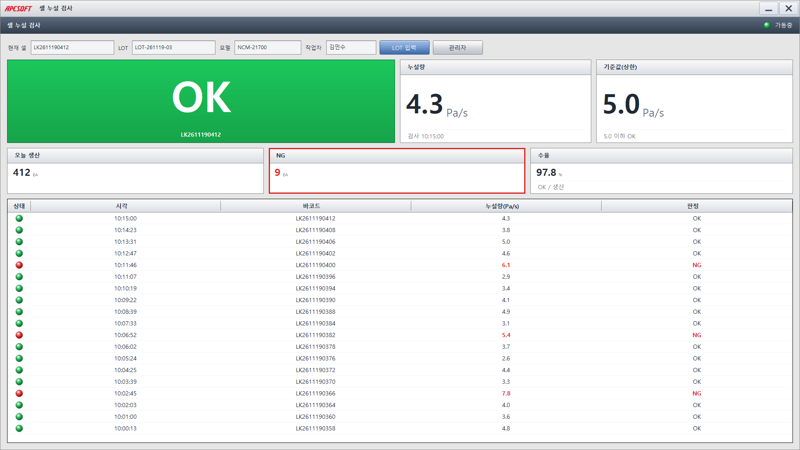
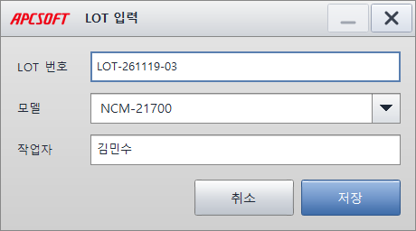

# 5회차 시연 B — 2차전지 셀 누설 검사기 (CellLeakTester)

> Sonnet 서브에이전트가 시연을 수행하고 보고 본문을 반환했다. 메인 세션이 그 본문을 저장했다. 프롬프트는 1회차와 같다.

## 1. 진행 과정 요약

- 템플릿
  - 메인 화면: `JudgeView`. 위쪽에 읽기 전용 칸 4개(바코드·LOT·모델·작업자)와 버튼 2개를 두었다.
  - LOT 입력 dialog: `RecipeDialog` 방식으로 만든 `LotEntryDialog`.
  - 관리자 비밀번호 dialog: `AdminPasswordDialog`.
- 처음에 한글이 든 heredoc으로 소스를 쓰다가 `unexpected EOF while looking for matching '`로 실패했다. 소스를 모두 Write 도구로 다시 썼다.
- render
  - 1회차에 `점검 1건`이 나왔다: 표 세로 스크롤바(행 22 중 19행 보임). 이력 샘플을 19행으로 줄였다.
  - 2회차에 `점검 0건`. dialog 2개는 처음부터 `점검 0건`이었다.
- 눈으로 보고 고친 것은 없다.

## 2. 결과 화면

- OK 판정판, 누설량 4.3, 기준 5.0, 오늘 집계(생산 412 · NG 9 · 수율 97.8 %), 이력 19행.
- 5.0인 행은 OK로, NG 3건은 빨간 굵은 글씨로 나온다. 헤더는 "가동중"이다.

## 3. 빌드/render 최종 결과

| 항목 | 결과 |
|---|---|
| 빌드 | 경고 0, 오류 0 |
| MainForm / LotEntryDialog / AdminPasswordDialog | 점검 0건 / 0건 / 0건 |

## 4. 정한 기준값

- 상한 5.0 Pa/s는 요구서 값이다. 5.0은 OK, 5.0 초과는 NG로 판정한다. 경고 구간은 두지 않았다.
- 소수 자리: Pa/s는 `0.0`, 수율은 `0.0`, 수량은 `#,0`.
- 수율 = (생산 − NG) / 생산.

## 5. 스킬 피드백 (에이전트 보고)

1. heredoc 실패가 또 나왔다(에이전트는 자기 실수라고 했다). "소스는 Write 도구만" 안내를 문서 맨 앞에 두자고 제안했다.
2. 판정 화면 헤더의 "NG 발생"이 최근 1건 기준인지 오늘 누적 기준인지 규칙이 없다. 최근 1건 기준으로 정했다.
3. 판정판 SubText와 기준값 카드의 Status는 규칙이 없어서 템플릿과 기존 규칙(Run)을 따랐다.
4. `Row()` 안의 읽기 전용 칸 폭을 정하는 기준이 없다.
5. 집계 카드(높이 110)는 값 글자가 작다. 높이를 키우면 이력 행 수가 줄어서 그대로 두었다.

## 메인 세션 확인

- PNG에서 규칙 위반은 보이지 않았다.
- 집계 카드의 단위 "EA"가 작게 보인다. 컨트롤이 카드 높이에 따라 글자 크기를 정하는 동작이고, 읽을 수는 있다.
