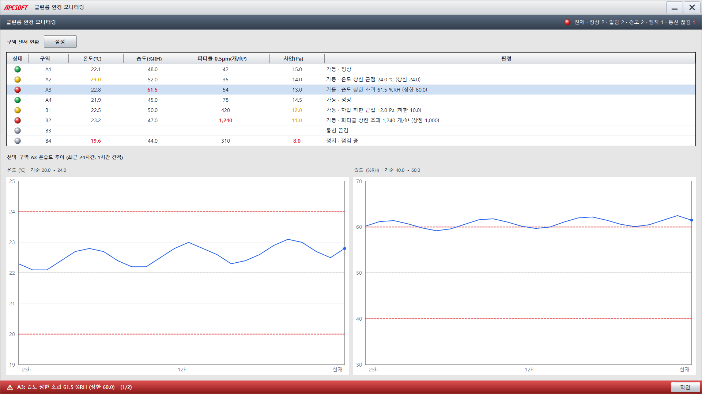
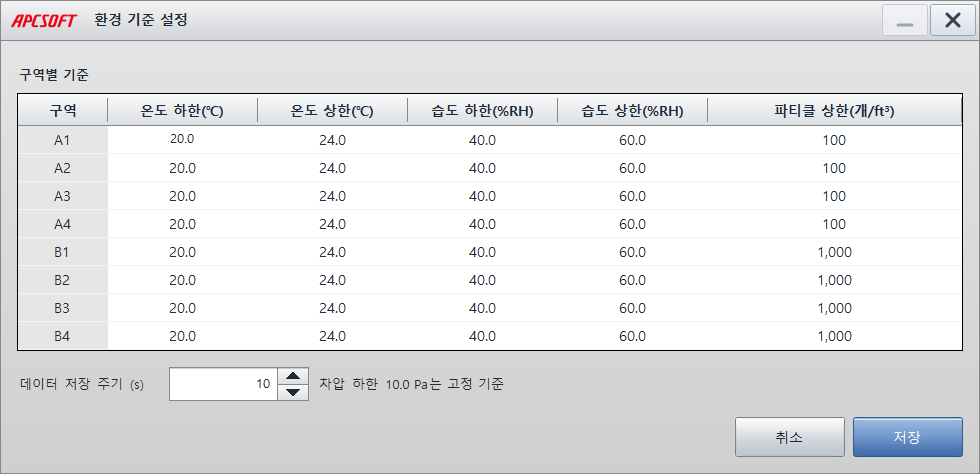

# 5회차 시연 C — 클린룸 환경 모니터링 (CleanroomMonitor)

> 이 시연은 Sonnet 서브에이전트가 했다. 에이전트가 돌려준 보고 본문을 메인 세션이 이 파일로 저장했다. 프롬프트는 1회차와 같다.

## 1. 진행 과정 요약

- **메인 화면:** `ApcTemplateView` 위에 새로 배치했다. `EquipmentView`와 `TempHumiView`를 참고했다.
- **설정 dialog:** `LotInputDialog`처럼 입력 표 방식으로 만들었다. 4b 규칙대로다.
- **소스 작성:** 모두 Write 도구로 썼다. heredoc은 쓰지 않았다.
- **빌드 경고 수정:** CS0108 경고가 1건 나왔다. `Text(int,int)` 헬퍼가 `Form.Text`를 가렸기 때문이고, 이름을 바꿔 없앴다.
- **render:** 처음부터 `점검 0건`이었다.
- **눈으로 보고 고친 것 2건**
  - 짧은 값 열까지 Fill로 되어 있던 표 열 폭을 고쳤다. 4-1 기준대로 긴 글 열(판정)만 Fill이다.
  - 왼쪽으로 정렬했던 판정 열 제목을 가운데로 되돌렸다.

## 2. 결과 화면

- **헤더:** "전체 · 정상 2 · 알람 2 · 경고 2 · 정지 1 · 통신 끊김 1"
- **구역 표 8행:** 기준을 벗어난 셀은 상태색에 굵게 표시했다. A3을 선택했고, 아래에 A3의 온도·습도 추이가 나온다.
- **B4(정지):** 읽은 값 셀이 빨간색인데, 헤더의 알람 수에는 들어가지 않는다. 아래 피드백 6번에서 다룬다.

## 3. 빌드/render 최종 결과

| 항목 | 결과 |
|---|---|
| 빌드 | 경고 0, 오류 0 |
| MainForm / SettingsDialog | 점검 0건 / 0건 |

## 4. 정한 기준값

| 항목 | 기준 |
|---|---|
| 온도 | 20.0~24.0 ℃, 경고 폭 0.5 |
| 습도 | 40.0~60.0 %RH, 경고 폭 2.0 |
| 파티클 | 상한 A구역 100 / B구역 1,000, 상한의 80 %부터 경고 |
| 차압 | 하한 10.0 Pa, 12.0 이하부터 경고 (고정값) |
| 저장 주기 | 10 s |

## 5. 스킬 피드백 (에이전트 보고)

1. 그래프 한 개에 계열(값 줄)을 하나만 넣을 수 있다. 그래서 온도·습도 그래프를 2개 나란히 직접 짰다.
2. 그래프 X축 이름표(`XLabels`)의 표기 기준이 없다.
3. Fill이 아닌 열의 고정 폭을 정하는 기준이 없다.
4. 글 열은 왼쪽 정렬인데 그 위 제목은 가운데라 어색하다. 규칙대로 가운데로 두었다.
5. 헤더 요약 순서에 "통신 끊김"의 자리가 없다.
6. 정지 구역 B4의 빨간 셀이 헤더 알람 수와 어긋나 보인다. 의도한 것인지 명시가 없다.
7. 입력 표 `ApcGrid`의 속성 조합은 템플릿에만 있다.
8. dialog 입력 검증 Alert의 문구 기준이 없다.
9. 입력 표 칸의 단위는 열 제목에 넣었다.
10. 제목과 버튼을 한 줄에 두는 방법이 4a에 없다.
11. 숫자칸 옆에 안내 문구를 붙이는 용도(`trailing`)가 4b에 없다.

## 메인 세션 확인

PNG에서 6번을 확인했다. 정지 구역 B4의 19.6과 8.0이 빨간색인데, 헤더의 알람 수는 2로 A3·B2만 센다. 4회차에 정한 규칙("정지 설비 값은 카드·셀에서만 판정")에서 생긴 어긋남이다.
