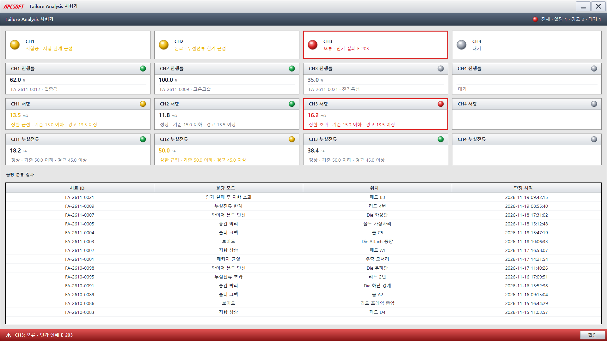
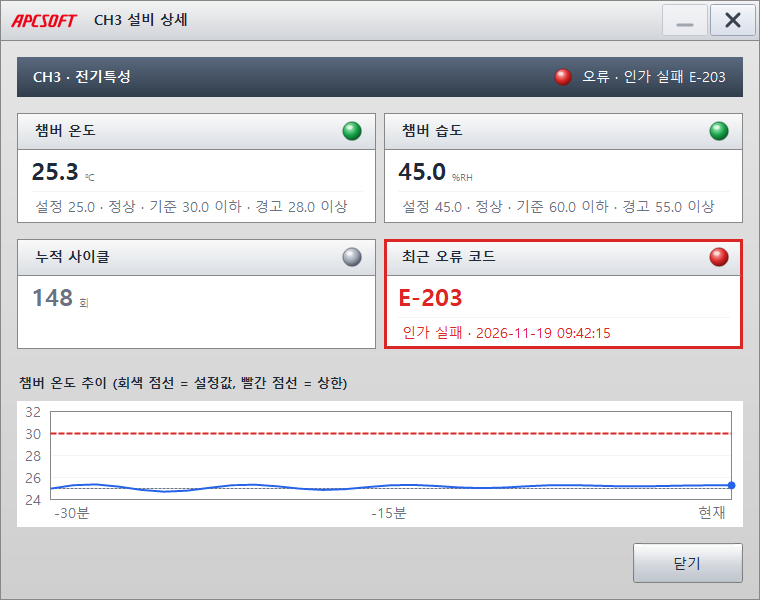

# 5회차 시연 D — 반도체 패키지 FA 시험기 (FATester)

> Sonnet 서브에이전트가 시연을 수행하고 보고 본문을 반환했다. 메인 세션이 그 본문을 저장했다. 프롬프트는 1회차와 같다.

## 1. 진행 과정 요약

- 템플릿: 메인은 `EquipmentView`, dialog는 `EquipmentDetailDialog`를 출발점으로 썼다.
- render 1회차: `점검 0건`. "참고: 표 아래가 빔"이 나와 불량 표를 14행으로 늘렸다.
- render 2회차: `점검 0건`, 참고 줄도 없었다.
- 눈으로 보고 고친 것은 없다.

## 2. 결과 화면

- 타일 4개, 채널별 카드 3줄, 불량 표 14행(여러 날짜라 `yyyy-MM-dd HH:mm:ss`).
- CH3(오류) 진행률 카드는 회색 `Stop`이다. 3회차에 정한 규칙이 반영됐다.
- CH2 누설전류 50.0은 상한과 같은 값이라 경고다.

## 3. 빌드/render 최종 결과

| 항목 | 결과 |
|---|---|
| 빌드 | 경고 0, 오류 0 |
| MainForm / ChannelDetailDialog | 점검 0건 / 0건 |

## 4. 정한 기준값

- 저항: 경고 13.5 mΩ 이상, 상한 15.0 mΩ
- 누설전류: 경고 45.0 nA 이상, 상한 50.0 nA
- 진행률: `0.0`, 누적 사이클: `#,0`
- 챔버 기준표(채널별 온도·습도 설정·경고·상한)는 dialog 카드에서만 판정한다.

## 5. 스킬 피드백 (에이전트 보고)

1. **단위 소수 자리:** mΩ·nA·진행률 %·"회"의 자리수가 규칙에 없다. 질문 금지 지시와 "묻는다" 규칙이 충돌했다.
2. **완료 채널 진행률 카드:** "갱신 중이면 Run, 멈췄으면 Stop" 중 어느 쪽인지 정해져 있지 않다. Run으로 짐작했다.
3. **오류 코드 카드:** 지난 오류 기록 카드의 Status(Info로 짐작)와, 오류가 없을 때의 표시 방법이 정해져 있지 않다.
4. **`Selected` 표시:** 채널 4개를 한 화면에 모두 보여 주는 경우에는 `Selected` 대상이 아니라고 판단했다.
5. **타일 판정:** 메인 화면에 보이지 않는 챔버 값은 타일 판정에서 뺐다.
6. **불량 표 램프 열:** 모든 행이 불량이라 램프 열을 두지 않았다.
